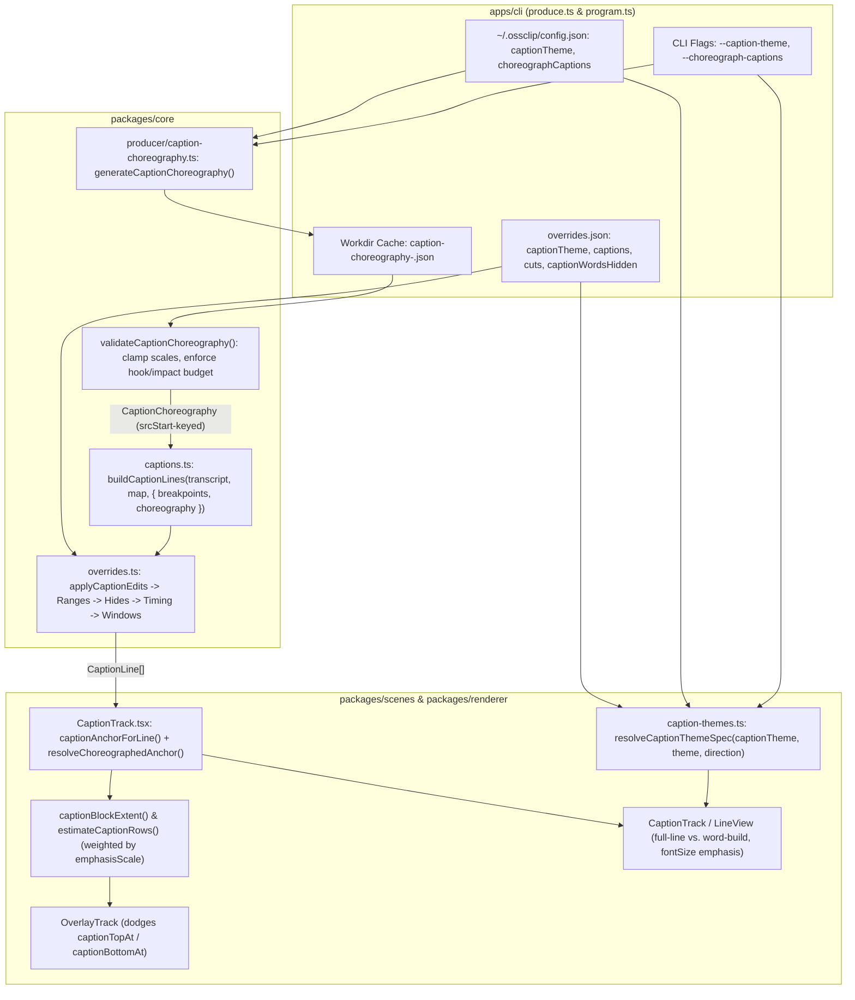

# AI Choreographed Captions & Caption Themes

*   **Author:** Muhammad Ahsan Ayaz
*   **Status:** Draft
*   **Date:** 2026-11-11

--------------------------------------------------------------------------------

## Overview

`ossclip` generates burned-in captions for short-form and long-form videos by packing transcript words into fixed-size lines (3 words over 1.2s in 9:16 portrait; 6 words over 2.4s in 16:9 landscape) and rendering them with a single visual treatment: bold white display type, a black outline, a drop shadow, and an active-word color highlight at a fixed vertical anchor (`y = 0.76`).

This design introduces two orthogonal capabilities across the CLI (`ossclip produce`) and the web editor (`ossclip edit`), gated behind a standalone interactive HTML mock page for visual verification prior to Remotion integration:

1.  **Caption Themes (`--caption-theme <preset>` / config `captionTheme`)**: A deterministic styling and reveal preset system with five built-in themes (`default`, `founder`, `punch`, `boxed`, `minimal`). Each theme defines typography weight and tracking, background pills or full-line boxes, stroke and shadow treatments, color mappings derived from the active [`Theme`](file:///home/ahsanayaz/code/ossclip/packages/core/src/scene-schema.ts#L276-L291), and word reveal mechanics (`full-line` vs. progressive `word-build`). Caption themes operate without an LLM call.
2.  **AI Caption Choreography (`--choreograph-captions` / config `choreographCaptions`)**: An optional, cached, mechanical-tier LLM pass over the kept transcript words. It groups words into semantic phrases rather than fixed word counts, assigns bounded per-word size multipliers (`1.0x` to `1.4x`) to emphasize hooks or metrics, and places opening hook chunks (and sparse high-emphasis beats) into clear bands around the speaker's measured [`FaceBox`](file:///home/ahsanayaz/code/ossclip/packages/core/src/face.ts#L21-L32) while keeping main-body captions at a predictable reading anchor.

## The Problem

Viewers on X, Instagram Reels, YouTube Shorts, and LinkedIn frequently watch product launch demos and developer videos on mute. Today's caption pipeline in [`captions.ts`](file:///home/ahsanayaz/code/ossclip/packages/core/src/captions.ts#L244-L314) and [`CaptionTrack.tsx`](file:///home/ahsanayaz/code/ossclip/packages/scenes/src/CaptionTrack.tsx#L540-L610) has three limitations:

1.  **Arbitrary 3-Word Breaks Split Semantic Phrases**: [`buildCaptionLines`](file:///home/ahsanayaz/code/ossclip/packages/core/src/captions.ts#L244-L314) flushes a line as soon as it hits `maxWordsPerLine` (`3` in portrait) or `maxLineDuration` (`1.2s`). A spoken hook such as `"We shipped this in 48 hours"` splits mid-thought into `"We shipped this"` and `"in 48 hours"`, weakening the visual punch of `"48 hours"` and forcing viewers to piece phrases together across flashes.
2.  **Uniform Word Sizing and Static Hook Placement**: Every word in a line renders at the exact same font size (`64px` portrait, `44px` landscape), and every line in a talking-head opening sits at `DEFAULT_CAPTION_ANCHOR` (`0.76`). Creators cannot visually accent the core metric or hook keyword via scale, nor can the opening hook use open headroom above or around the speaker's face to grab attention in the first 3 seconds.
3.  **Single Visual Look**: Creators making raw product demos (such as the builder-style launch videos popularized by HeyClicky) need clean, pill-highlighted or boxed typography without heavy `10px` black strokes, whereas high-energy short-form clips benefit from progressive word build-in and heavy offset shadows. Today, changing [`Theme`](file:///home/ahsanayaz/code/ossclip/packages/core/src/scene-schema.ts#L276-L291) only swaps font family and hex colors (`fg`, `accent`), leaving stroke width, pill backings, and reveal mechanics hardcoded.

The proposed solution decouples **visual styling (`CaptionTheme`)** from **semantic phrasing and spatial staging (`CaptionChoreography`)**, feeding choreography into [`buildCaptionLines`](file:///home/ahsanayaz/code/ossclip/packages/core/src/captions.ts#L244-L314) as source-anchored (`srcStart`) phrase breaks and word metadata so that live cuts, word hiding, and word retyping in `ossclip edit` continue to work deterministically in the browser without calling an LLM.

## Goals

*   **G1 — Pre-Integration Interactive HTML Mock Page**: Deliver a standalone HTML/CSS/JS preview page that renders all five caption themes (`default`, `founder`, `punch`, `boxed`, `minimal`), both `word-build` strategies (slot-reserved vs. dynamic reflow), multi-word emphasis sizing (`1.0x`–`1.4x`), Urdu Nastaliq RTL lines, and `FaceBox` safe-zone overlays on 9:16 and 16:9 stages at 30fps before modifying Remotion components.
*   **G2 — Five Deterministic Caption Themes**: Support `--caption-theme <preset>` (`default | founder | punch | boxed | minimal`), `captionTheme` in `~/.ossclip/config.json`, and `captionTheme` in `overrides.json` with strict precedence (`overrides.json > CLI flag > config.json > "default"`), zero LLM dependency, and `command.json` replay pinning.
*   **G3 — Byte-Identical Default Behavior**: When `captionTheme` is omitted or `"default"` and `choreographCaptions` is off, [`buildCaptionLines`](file:///home/ahsanayaz/code/ossclip/packages/core/src/captions.ts#L244-L314) and [`CaptionTrack`](file:///home/ahsanayaz/code/ossclip/packages/scenes/src/CaptionTrack.tsx#L540-L610) must produce byte-identical data structures, DOM attributes, and rendered pixels compared to pre-feature runs.
*   **G4 — Independent, Cached AI Choreography Pass**: Support `--choreograph-captions` / `--no-choreograph-captions` (and config `choreographCaptions`) as a standalone cached LLM pass (`caption-choreography-<hash>.json`) using the mechanical/fast model tier, operable with or without `--produce` scene graphics.
*   **G5 — Deterministic Guardrails & Spatial Stability**: Validate and normalize LLM choreography output (`validateCaptionChoreography`) so transcript text, word order, and word count can never be altered by the LLM; clamp per-word emphasis scales to `[1.0, 1.4]` (max 2 emphasized words per phrase); and restrict non-default `FaceBox`-aware safe-zone placement to the opening hook (`t < 4.0s`, max 2 phrases) and rare impact phrases (`<= 2` words, max 1 per 15s) during plain `full-bleed` takes.
*   **G6 — Full Editor & Overlay Geometry Compatibility**: Preserve semantic phrase groupings, per-word `emphasisScale`, and line `anchorY` across editor word retypes (`applyCaptionEdits`), range edits (`applyCaptionRangeEdits`), word hides (`applyCaptionWordHides`), live cuts (`rebuildCaptionTrack`), and [`OverlayTrack`](file:///home/ahsanayaz/code/ossclip/packages/scenes/src/overlay-track.tsx) bounding-box avoidance (`captionBlockExtent`).
*   **G7 — RTL / Urdu Nastaliq Safety**: Prevent Arabic-script ligature breakage or vertical glyph clipping across all five themes by disabling `uppercase` transforms, negative letter-spacing, and tight vertical pill constraints whenever `lineDirection(text) === "rtl"`.

## Non-Goals

*   **NG1 — Body Segmentation or Depth Matting**: Placing captions behind the speaker's torso or shoulders via per-frame person-segmentation ML models is out of scope; safe-zone placement uses the existing 2D [`FaceBox`](file:///home/ahsanayaz/code/ossclip/packages/core/src/face.ts#L21-L32) cascade detector (`headBand` + `freeBands`).
*   **NG2 — Freeform Canvas Coordinates or Rotated Text**: The LLM will not emit raw X/Y pixel coordinates, arbitrary rotation angles, or multi-axis curved text paths.
*   **NG3 — Browser-Side LLM Calls in `ossclip edit`**: Cutting words, toggling silence removals, or editing text in the web editor will never trigger a live LLM call; all re-packing happens deterministically in the browser from the stored `CaptionChoreography` metadata.
*   **NG4 — Custom User-Authored CSS Theme Files**: v1 ships the five curated presets (`default`, `founder`, `punch`, `boxed`, `minimal`) parameterized by the user's existing [`Theme`](file:///home/ahsanayaz/code/ossclip/packages/core/src/scene-schema.ts#L276-L291) tokens (`fg`, `accent`, `fontDisplay`).

## Open Questions

*   *None at this stage — all initial product and architectural ambiguities were resolved during the `/egm:egm-brainstorm` phase.*

## Critical User Journeys (CUJs)

### CUJ 1: Selecting a Caption Theme Without AI Choreography

*   **Given**: A user has a local video `demo.mp4` and wants clean builder-style pill captions (`founder`) without running AI caption choreography or `--produce` scene graphics.
*   **When**: The user runs `ossclip produce demo.mp4 --caption-theme founder` (or sets `"captionTheme": "founder"` in `~/.ossclip/config.json`).
*   **Then**: `ossclip` validates the preset name via `CaptionThemeIdSchema`, packs captions deterministically using [`buildCaptionLines`](file:///home/ahsanayaz/code/ossclip/packages/core/src/captions.ts#L244-L314), records `"--caption-theme", "founder"` in `command.json` for replay, writes `captionTheme: "founder"` into `production.json` and `render-props.json`, and renders the video with the `founder` preset (weight 800, rounded accent pill on the active word, `2px` outline, dimmed inactive words) with zero LLM choreography calls.

### CUJ 2: Producing a Video with AI Choreographed Captions and a Theme

*   **Given**: A user has a talking-head launch video `launch.mp4` with a measured [`FaceBox`](file:///home/ahsanayaz/code/ossclip/packages/core/src/face.ts#L21-L32) and runs `ossclip produce launch.mp4 --choreograph-captions --caption-theme punch`.
*   **When**: The transcription and silence-cut phases complete.
*   **Then**:
    1.  `ossclip` computes `captionChoreographyCacheKey` over the kept transcript words, aspect ratio, and prompt version, and invokes `generateCaptionChoreography` on the fast/mechanical LLM tier (unless cached in `caption-choreography-<hash>.json`).
    2.  `validateCaptionChoreography` normalizes the response, ensuring all kept words are covered in order, clamping `emphasisScale` to `[1.0, 1.4]`, and restricting `role: "hook"` to the first 4.0 seconds (max 2 phrases) and `role: "impact"` to at most 1 short phrase per 15 seconds.
    3.  [`buildCaptionLines`](file:///home/ahsanayaz/code/ossclip/packages/core/src/captions.ts#L244-L314) packs words along the semantic phrase breaks while still flushing at any graphic scene `breakpoints`, attaching `emphasisScale` to each [`CaptionWord`](file:///home/ahsanayaz/code/ossclip/packages/core/src/captions.ts#L10-L21) and safe-zone `anchorY` / `role` to each [`CaptionLine`](file:///home/ahsanayaz/code/ossclip/packages/core/src/captions.ts#L23-L27).
    4.  [`CaptionTrack`](file:///home/ahsanayaz/code/ossclip/packages/scenes/src/CaptionTrack.tsx#L540-L610) renders the opening hook in the clear vertical band above/below the speaker's head (avoiding `headBand(face)`, `SAFE_AREA`, and `sourceTextRegions`), renders emphasized words at `fontSizePx * emphasisScale` without horizontal collision, and reveals words progressively (`word-build`) in the `punch` style while keeping main-body captions anchored at `y = 0.76`.

### CUJ 3: Live Cutting and Word Retyping in `ossclip edit`

*   **Given**: A project produced with `--choreograph-captions --caption-theme boxed` is opened in `ossclip edit`.
*   **When**: The user cuts a sentence in the transcript panel, hides a filler word, retypes a caption word, or drags a scene's `captionY` slider in the inspector.
*   **Then**:
    1.  `rebuildCaptionTrack` in [`liveCaptionTrack.ts`](file:///home/ahsanayaz/code/ossclip/apps/editor/src/liveCaptionTrack.ts#L113-L147) re-runs [`buildCaptionLines`](file:///home/ahsanayaz/code/ossclip/packages/core/src/captions.ts#L244-L314) in the browser using the stored `captionChoreography` metadata keyed by word `srcStart`.
    2.  Surviving words keep their semantic phrase breaks and `emphasisScale` multipliers; hiding a single word via [`applyCaptionWordHides`](file:///home/ahsanayaz/code/ossclip/packages/core/src/overrides.ts#L2283) preserves the line's `anchorY` and `role`; and any user-set per-scene `captionY` override takes precedence over the choreographed `anchorY`.

### CUJ 4: Visually Validating Themes in the Interactive HTML Mock Page

*   **Given**: A developer or creator opens the standalone HTML mock page in a browser before running full video renders.
*   **When**: They switch between `default`, `founder`, `punch`, `boxed`, and `minimal`, toggle between 9:16 portrait and 16:9 landscape, scrub the 30fps timeline, toggle `slot-reserved` vs. `dynamic-reflow` word build-in, and switch to the Urdu Nastaliq RTL sample line.
*   **Then**: The page renders the exact CSS styles, stroke scaling, pill geometry, `FaceBox` head-band overlay, and word-pop easing curves in real time so visual polish can be verified in seconds.

## Technical Plan (Architecture)

### 1. System Data Flow

The architecture separates **theme preset resolution** (pure styling and reveal mechanics) from **caption choreography** (semantic phrase breaks, per-word size multipliers, and hook/impact role tags). Both feed into [`buildCaptionLines`](file:///home/ahsanayaz/code/ossclip/packages/core/src/captions.ts#L244-L314) and [`CaptionTrack`](file:///home/ahsanayaz/code/ossclip/packages/scenes/src/CaptionTrack.tsx#L540-L610), shared identically between CLI rendering and the browser editor.



### 2. Caption Theme Preset Architecture (`CaptionThemeId` & `CaptionThemeSpec`)

Instead of adding 15 caption-specific CSS properties onto [`ThemeSchema`](file:///home/ahsanayaz/code/ossclip/packages/core/src/scene-schema.ts#L276-L291), caption themes are modeled as a dedicated preset enum in [`captions.ts`](file:///home/ahsanayaz/code/ossclip/packages/core/src/captions.ts) (and re-exported through `@ossclip/core/browser`):

```ts
export const CAPTION_THEME_IDS = [
  "default",
  "founder",
  "punch",
  "boxed",
  "minimal",
] as const;

export const CaptionThemeIdSchema = z.enum(CAPTION_THEME_IDS);
export type CaptionThemeId = z.infer<typeof CaptionThemeIdSchema>;
```

At render time in `@ossclip/scenes`, `resolveCaptionThemeSpec(presetId, theme, direction)` combines the preset's structural rules with the user's [`Theme`](file:///home/ahsanayaz/code/ossclip/packages/core/src/scene-schema.ts#L276-L291) palette (`theme.fg`, `theme.accent`, `theme.fontDisplay`) and the line's bidi direction (`"ltr" | "rtl"`):

| Property | `default` | `founder` | `punch` | `boxed` | `minimal` |
| :--- | :--- | :--- | :--- | :--- | :--- |
| **`revealMode`** | `"full-line"` | `"full-line"` | `"word-build"` | `"full-line"` | `"word-build"` |
| **`fontScale`** | `1.0` | `0.92` | `1.08` | `0.95` | `0.84` |
| **`fontWeight`** | `900` | `800` | `900` | `800` | `700` |
| **`textTransform` (LTR)** | `"none"` | `"none"` | `"uppercase"` | `"none"` | `"none"` |
| **`letterSpacing` (LTR)** | `"normal"` | `"-0.02em"` | `"0.01em"` | `"-0.01em"` | `"0.01em"` |
| **`strokeRatio`** (`px` at `64px`) | `10` | `2` | `12` | `0` | `0` |
| **`shadowStyle`** | Soft drop (`24px` blur) | Crisp drop (`14px` blur) | Hard offset (`0 6px 0 rgba(0,0,0,0.9)`) | None (inside box) | Ambient double shadow |
| **`lineBoxStyle`** | None | None | None | Rounded dark pill (`rgba(10,10,12,0.86)`) | None |
| **`activeWordPill`** | None | Rounded `theme.accent` fill (`#0A0A0C` text) | Tilted badge (`-1.5deg`) when `emphasisScale > 1.15` | None | None |
| **`inactiveOpacity`** | `1.0` | `0.85` | `1.0` | `0.92` | `0.60` |
| **`popScaleAmp`** | `0.08` | `0.05` | `0.14` | `0.04` | `0.04` |

*   **Byte-Identical `default` Path**: When `captionTheme` is `undefined` or `"default"` and no word has `emphasisScale !== undefined`, [`LineView`](file:///home/ahsanayaz/code/ossclip/packages/scenes/src/CaptionTrack.tsx#L402-L533) executes the exact pre-feature style branch so existing DOM snapshot and pixel tests remain untouched.
*   **RTL / Nastaliq Guard**: Whenever `direction === "rtl"`, `resolveCaptionThemeSpec` forces `textTransform: "none"`, `letterSpacing: "normal"`, and expands vertical pill/box padding so `Noto Nastaliq Urdu` diagonal glyph stacks (`lineHeight: 1.9`) are never clipped or disconnected.

### 3. Source-Anchored AI Choreography Model (`CaptionChoreography`)

To survive browser-side recuts in `ossclip edit` without calling an LLM in the browser, the LLM choreography pass is converted into a source-anchored data structure (`CaptionChoreography`) stored in `production.json` and `render-props.json`:

```ts
export const CaptionPhraseRoleSchema = z.enum(["hook", "body", "impact"]);
export type CaptionPhraseRole = z.infer<typeof CaptionPhraseRoleSchema>;

export const CaptionChoreographyWordSchema = z.object({
  /** Emphasis font-size multiplier, clamped to [1.0, 1.4]. Omit when 1.0. */
  emphasisScale: z.number().min(1).max(1.4).optional(),
});

export const CaptionChoreographyPhraseSchema = z.object({
  /** Source timestamp (srcStart) of the first word in this semantic phrase. */
  startSrcSec: z.number().finite().nonnegative(),
  /** Source timestamp (srcStart) of the last word in this semantic phrase. */
  endSrcSec: z.number().finite().nonnegative(),
  /** Semantic staging role; defaults to "body". */
  role: CaptionPhraseRoleSchema.optional(),
});

export const CaptionChoreographySchema = z.object({
  phrases: z.array(CaptionChoreographyPhraseSchema),
  /** Keyed by captionKeyFor({ srcStart }) ("w<ms>"), matching OverrideDoc.captions. */
  words: z.record(z.string(), CaptionChoreographyWordSchema).default({}),
});
export type CaptionChoreography = z.infer<typeof CaptionChoreographySchema>;
```

#### How `generateCaptionChoreography` and `validateCaptionChoreography` Work

1.  **Prompt & Mechanical Tier**: `generateCaptionChoreography` (in `packages/core/src/producer/caption-choreography.ts`) sends the indexed kept words (with word index, text, and speech gap to next word) plus aspect ratio (`9:16` or `16:9`) to `provider.complete({ tier: "mechanical", schema: RawChoreographyLlmSchema })`. The LLM returns contiguous word index ranges `[startWord, endWord]`, optional phrase `role` (`"hook" | "body" | "impact"`), and optional word emphasis entries `{ word: number, scale: number }`.
2.  **Deterministic Validator (`validateCaptionChoreography`)**:
    *   **Full Coverage Without Word Mutation**: The validator walks the kept words `0 .. N-1` in order. Any gap, overlap, or out-of-range index in the LLM's phrase ranges is repaired by partitioning uncovered spans with the default greedy word packer (`maxWordsPerLine`: 4 portrait / 7 landscape). The LLM never emits word strings, so it is structurally impossible for it to hallucinate or drop transcript text.
    *   **Phrase Length Ceiling**: Any LLM phrase exceeding `maxChoreographedWords` (`5` in portrait, `8` in landscape) or spanning a speech pause `> maxGap` (`0.6s`) is split deterministically.
    *   **Emphasis Budget**: Per-word `scale` is clamped to `[1.0, 1.4]`. At most 2 words per phrase (and at most 25% of all words in the transcript) may keep `emphasisScale > 1.05`; excess lower-ranked emphasis entries are dropped so emphasis remains selective.
    *   **Spatial Stability Budget**:
        *   `role: "hook"` is permitted only on phrases starting within the first `4.0` output seconds (at most the first 2 phrases). Any later phrase tagged `"hook"` is downgraded to `"body"`.
        *   `role: "impact"` is permitted only on phrases of `<= 2` words with at least one emphasized word (`>= 1.15x`), spaced at least `15.0` output seconds apart. Any other `"impact"` tag is downgraded to `"body"`.
    *   **Source-Time Conversion**: Validated word indices are converted into `CaptionChoreography` (`startSrcSec`, `endSrcSec`, and `words[captionKeyFor(w)]`) so the artifact is immune to subsequent timeline cuts.

#### How `buildCaptionLines` Consumes `CaptionChoreography`

[`CaptionWord`](file:///home/ahsanayaz/code/ossclip/packages/core/src/captions.ts#L10-L21) and [`CaptionLine`](file:///home/ahsanayaz/code/ossclip/packages/core/src/captions.ts#L23-L27) gain optional fields (omitted when absent so unchoreographed runs remain byte-identical):

```ts
export interface CaptionWord {
  text: string;
  start: number;
  end: number;
  srcStart: number;
  /** Per-word font-size multiplier from AI choreography (1.0..1.4). */
  emphasisScale?: number;
}

export interface CaptionLine {
  words: CaptionWord[];
  start: number;
  end: number;
  /** Semantic role from AI choreography; absent on unchoreographed lines. */
  role?: CaptionPhraseRole;
}
```

When `opts.choreography` is passed to [`buildCaptionLines`](file:///home/ahsanayaz/code/ossclip/packages/core/src/captions.ts#L244-L314):
*   Each mapped `CaptionWord` looks up `choreography.words[captionKeyFor(w)]?.emphasisScale`.
*   Instead of flushing strictly at `maxWordsPerLine` (`3` portrait / `6` landscape), the packer flushes whenever the next word crosses a choreographed phrase boundary (`w.srcStart > activePhrase.endSrcSec + 1e-6`), while **still** flushing at scene-cue `breakpoints`, `maxGap`, and a safety ceiling (`5` words / `2.2s` portrait, `8` words / `3.2s` landscape).
*   If all surviving words in a flushed line came from a `"hook"` or `"impact"` phrase (and the phrase was not split across a graphic scene cue), the line receives `role: activePhrase.role`.

### 4. FaceBox-Aware Safe-Zone Placement & Overlay Collision Geometry

In [`CaptionTrack.tsx`](file:///home/ahsanayaz/code/ossclip/packages/scenes/src/CaptionTrack.tsx#L196-L216), `captionAnchorForLine` determines `{ anchor, scale }` for each line:

1.  **Precedence Ladder**:
    *   **Priority 1 (User Per-Scene Override)**: If `activeCue?.captionY !== undefined`, return `activeCue.captionY` directly.
    *   **Priority 2 (Choreographed `"hook"` or `"impact"` Line)**: If `line.role === "hook" || line.role === "impact"`, call `resolveChoreographedAnchor(line, activeCue, face, sourceTextRegions, frame, watermark)`:
        *   Only eligible when `activeCue` is a full-frame camera layout (`layout === "full-bleed"` with `kind === "plain"`, or no graphic occupying the frame) and `face?.subject !== "screen"`.
        *   Compute the speaker's head band in **output frame fractions** by projecting `headBand(face)` ([`stage.ts`](file:///home/ahsanayaz/code/ossclip/packages/scenes/src/stage.ts#L452-L457)) through the active video slot's vertical crop shift.
        *   Collect all blocked vertical intervals during `[line.start, line.end]`: the projected `headBand`, `regionsDuring(sourceTextRegions, line.start, line.end)`, any active `graphicRect`, and (when `watermark === true` and `line.role === "hook"`) the top-left watermark band (`y: safe.top, h: 0.06`).
        *   Run `freeBands({ start: safe.top, end: 1 - safe.bottom }, blocked)` ([`stage.ts`](file:///home/ahsanayaz/code/ossclip/packages/scenes/src/stage.ts#L421-L438)).
        *   For `"hook"`, prefer an upper free band (above the head, e.g., `y` in `0.14 .. 0.32`) if its height is at least `MIN_HOOK_BAND_H` (`0.14`); otherwise prefer the tallest clear band below the chin (`0.58 .. 0.82`). Return the band's center as `anchor`.
    *   **Priority 3 (Standard Main-Body Anchor)**: Fall through to today's `captionAnchorAvoiding(...)` (`0.76` in portrait `full-bleed`).
2.  **Emphasis-Aware Bounding Box for `OverlayTrack`**:
    *   [`estimateCaptionRows`](file:///home/ahsanayaz/code/ossclip/packages/scenes/src/CaptionTrack.tsx#L256-L274) and [`captionBlockExtent`](file:///home/ahsanayaz/code/ossclip/packages/scenes/src/CaptionTrack.tsx#L293-L309) are updated to multiply each word's estimated advance width by `w.emphasisScale ?? 1` and the line's row height by `max(w.emphasisScale ?? 1) * themeSpec.fontScale`.
    *   Because `captionTopAtFor` and `captionBottomAtFor` call `captionBlockExtent`, [`OverlayTrack`](file:///home/ahsanayaz/code/ossclip/packages/scenes/src/overlay-track.tsx) and `overlaysWithoutRoom` in [`produce.ts`](file:///home/ahsanayaz/code/ossclip/apps/cli/src/produce.ts#L4886) automatically clear both upper-zone hook captions and enlarged emphasis words.

### 5. Spatial vs. Temporal Word Sizing and Progressive `word-build` in `LineView`

Inside [`LineView`](file:///home/ahsanayaz/code/ossclip/packages/scenes/src/CaptionTrack.tsx#L402-L533):
*   **Per-Word Emphasis (`fontSize`)**: A word with `w.emphasisScale` sets `fontSize: `${w.emphasisScale}em`` (or `fontSizePx * w.emphasisScale`) and `lineHeight: 1.05` inside the flex row (`alignItems: "baseline"`). This allocates real horizontal and vertical layout space once when the `<Sequence>` mounts, preventing enlarged words from overlapping neighbors.
*   **Per-Frame Active Pop (`transform: scale()`)**: The frame-driven active pop (`1 + themeSpec.popScaleAmp * pop`) stays on `style.transform`, avoiding per-frame layout reflows.
*   **Progressive `word-build` Reveal**: When `themeSpec.revealMode === "word-build"`, all word `<span>`s in `line.words` remain mounted for the full `<Sequence>` (so flex layout coordinates and editor `data-caption-src` DOM hit-targets never shift mid-line). For unspoken words (`t < w.start`), `opacity` is `0` and `transform` holds `translateY(6px) scale(0.92)`, ramping to `opacity: 1` and the active pop over `CAPTION_POP_SEC` (`0.12s`) as `t` crosses `w.start`.

### 6. CLI Flags, Config, Overrides, and Cache Key

1.  **CLI Flags in [`program.ts`](file:///home/ahsanayaz/code/ossclip/apps/cli/src/program.ts)**:
    *   `--caption-theme <preset>`: Validated at parse time via `CaptionThemeIdSchema.safeParse`; throws `InvalidArgumentError` listing `default, founder, punch, boxed, minimal` on unknown input.
    *   `--choreograph-captions` / `--no-choreograph-captions`: Tri-state boolean pair (positive declared first so commander's default is `undefined`, matching `--watermark` and `--cover-in-video`).
2.  **Config & Overrides**:
    *   [`OssclipConfig`](file:///home/ahsanayaz/code/ossclip/packages/core/src/config.ts#L11-L240) adds `captionTheme?: string` and `choreographCaptions?: boolean` (copied in `resolveConfig` and validated at consumption in `produce.ts` via `resolveCaptionTheme` and `resolveChoreographCaptions`).
    *   [`OverrideDocSchema`](file:///home/ahsanayaz/code/ossclip/packages/core/src/overrides.ts#L552) adds `captionTheme: CaptionThemeIdSchema.optional()`.
    *   [`applyCaptionWordHides`](file:///home/ahsanayaz/code/ossclip/packages/core/src/overrides.ts#L2283) is updated from `out.push({ words: kept, start, end })` to `out.push({ ...line, words: kept, start, end })` so `line.role` survives word hiding.
3.  **Workdir Cache Key (`captionChoreographyCacheKey`)**:
    *   Stored at `<workdir>/caption-choreography-<12-char-sha256>.json`.
    *   Hashes `{ version: CAPTION_CHOREOGRAPHY_PROMPT_VERSION, aspect, words: keptWords.map(w => ({ text: w.text, start: w.start, end: w.end })) }`.
    *   Follows the `logo-flags` pattern: caches the raw LLM output and runs `validateCaptionChoreography` on every read so tightening a validator constant takes effect immediately without busting the LLM cache.

## Alternatives Considered

### Alternative A: Per-Frame Body Segmentation for Placing Captions Around or Behind the Speaker's Torso

*   **Pros**: Allows placing large kinetic display text partially behind the speaker's shoulders or wrapping text tightly around body contours.
*   **Cons**: [`ossclip`](file:///home/ahsanayaz/code/ossclip/packages/core/src/face.ts) only computes a static 2D [`FaceBox`](file:///home/ahsanayaz/code/ossclip/packages/core/src/face.ts#L21-L32) via the pure-JS `pico` cascade (`measureFace` / `measureFaceInWindows`). Depth-matting captions behind a torso requires bundling a person-segmentation ML model, running inference per video frame, and compositing alpha masks in Remotion, increasing render time and package size.
*   **Reason for Rejection**: Rejected by author: `FaceBox`-derived safe zones (`headBand` + `freeBands`) already locate clear vertical space around the speaker's head for the opening hook without requiring a segmentation model.

### Alternative B: Merging Caption Choreography into the `--produce` Beat-Sheet LLM Call

*   **Pros**: Avoids a separate LLM request when `--produce` is already running.
*   **Cons**: Users frequently run `ossclip produce` without `--produce` (captions-only cuts without code-rendered scene graphics). Furthermore, the beat-sheet call runs on the editorial model tier (which has tight timeout budgets on providers like `antigravity`), whereas grouping words into semantic phrases is a mechanical task suited for the fast model tier (`DEFAULT_FAST_MODEL`).
*   **Reason for Rejection**: Rejected by author: Keeping `--choreograph-captions` as its own independent, cached LLM pass allows it to work with or without `--produce` and scale cleanly to editor workflows.

### Alternative C: Replacing `buildCaptionLines` with Pre-Baked LLM `CaptionLine[]` in `render-props.json`

*   **Pros**: Simpler initial CLI implementation because `produce.ts` writes the LLM's grouped lines directly to `render-props.json` without changing [`buildCaptionLines`](file:///home/ahsanayaz/code/ossclip/packages/core/src/captions.ts#L244-L314).
*   **Cons**: Whenever a user makes a cut or toggles a silence removal in `ossclip edit`, [`rebuildCaptionTrack`](file:///home/ahsanayaz/code/ossclip/apps/editor/src/liveCaptionTrack.ts#L113-L147) re-runs [`buildCaptionLines`](file:///home/ahsanayaz/code/ossclip/packages/core/src/captions.ts#L244-L314) in the browser. Pre-baked lines in `render-props.json` would be discarded on the first cut, losing all semantic phrase breaks, word emphasis scales, and `captionLineTiming` keys.
*   **Reason for Rejection**: Rejected by author: Storing choreography as source-anchored (`srcStart`) phrase break timestamps and word metadata consumed by [`buildCaptionLines`](file:///home/ahsanayaz/code/ossclip/packages/core/src/captions.ts#L244-L314) preserves choreography across live editor cuts without a browser LLM call.

--------------------------------------------------------------------------------

## Non-Functional Requirements

*   **Performance & LLM Token Economics**:
    *   `--caption-theme` alone makes zero network or LLM calls and adds negligible CPU overhead (`< 1ms` per render).
    *   `--choreograph-captions` uses `tier: "mechanical"` (`DEFAULT_FAST_MODEL`: Haiku 4.5 / Gemini Flash Lite / `gemini-flash-low`). For a 90-second clip (~220 words), the compact indexed word prompt uses ~800 input tokens and ~400 output tokens, cached by SHA-256 in `<workdir>/caption-choreography-<hash>.json`.
    *   Per-word `emphasisScale` is applied via `fontSize` (layout once per `<Sequence>`) while per-frame pop animation stays on `transform: scale()`, avoiding per-frame DOM reflows in Chromium during Remotion frame capture.
*   **Backward Compatibility & Rollback**:
    *   All new fields in `production.json`, `render-props.json`, `overrides.json`, and `config.json` (`captionTheme`, `captionChoreography`, `CaptionWord.emphasisScale`, `CaptionLine.role`) are optional (`undefined` when absent).
    *   Pre-existing `render-props.json` and `overrides.json` files parse and render byte-identically without migration.
    *   If the LLM choreography call fails or times out, `produce` logs a single `⚠` warning and falls back to standard deterministic [`buildCaptionLines`](file:///home/ahsanayaz/code/ossclip/packages/core/src/captions.ts#L244-L314) packing rather than aborting the video render.

--------------------------------------------------------------------------------

### Additional Resources

*   [`packages/core/src/captions.ts`](file:///home/ahsanayaz/code/ossclip/packages/core/src/captions.ts) — Current caption word/linepacker, `MAX_CAPTION_WORD_LEAD_SEC`, `MIN_CAPTION_LINE_DWELL_SEC`, and `Nastaliq` RTL helpers.
*   [`packages/scenes/src/CaptionTrack.tsx`](file:///home/ahsanayaz/code/ossclip/packages/scenes/src/CaptionTrack.tsx) — Current Remotion caption renderer, `captionAnchorForLine`, and `captionBlockExtent`.
*   [`packages/scenes/src/stage.ts`](file:///home/ahsanayaz/code/ossclip/packages/scenes/src/stage.ts) — `headBand(face)` and `freeBands` geometry solver.
*   [`apps/editor/src/liveCaptionTrack.ts`](file:///home/ahsanayaz/code/ossclip/apps/editor/src/liveCaptionTrack.ts) — Browser-side live caption re-packer for `ossclip edit`.
*   Y Combinator / Farza Majeed Launch Video Breakdown (`https://www.youtube.com/watch?v=v12aSIZIXUs`) — Inspiration for the `founder` preset's high-contrast, low-clutter keyword emphasis.

### Future Improvements

*   **Editor Inspector Theme Switcher & Per-Word Emphasis Slider**: Expose a dropdown in the `ossclip edit` top bar or inspector to switch `overrides.json.captionTheme` live in the browser Player, and allow clicking a word in the transcript panel to adjust its `emphasisScale` manually.

--------------------------------------------------------------------------------

## Detailed Implementation Plan

### Target Files to Create/Modify

#### 1. [`packages/scenes/caption-themes-mock.html`](file:///home/ahsanayaz/code/ossclip/packages/scenes/caption-themes-mock.html) (Create)

*   **Type / Scope**: Standalone Interactive HTML/CSS/JS Visual Verification Page (Stage 1 Gate).
*   **Rationale**: Allows rapid visual inspection and tuning of all five caption themes, both `word-build` modes (slot-reserved vs. dynamic reflow), multi-word emphasis sizing, Urdu Nastaliq RTL rendering, and `FaceBox` hook safe-zone placement on 9:16 and 16:9 stages before modifying Remotion components.
*   **Proposed Changes**:
    *   Create a self-contained HTML page with interactive controls for:
        1.  Preset selector (`default`, `founder`, `punch`, `boxed`, `minimal`) + side-by-side comparison mode.
        2.  Aspect ratio toggle (`9:16 Portrait` vs. `16:9 Landscape`).
        3.  Word-build strategy toggle (`slot-reserved` vs. `dynamic-reflow`).
        4.  Choreography & Safe-Zone overlay toggle showing `SAFE_AREA`, simulated `FaceBox`, `headBand(face)`, and upper hook placement (`y = 0.22`) vs. body anchor (`y = 0.76`).
        5.  Sample phrase switcher: Launch Hook with `1.35x` emphasis (`"We shipped HeyClicky in 48 HOURS"`), CTA Keyword (`"Comment \"AGENTS\" below"`), and code-switched Urdu Nastaliq RTL (`"2026 میں Fulfillment کے نئے اصول"`).
        6.  30fps playback loop and frame scrubber driving the `easeOutQuad` pop and progressive word reveal.

#### 2. [`packages/core/src/captions.ts`](file:///home/ahsanayaz/code/ossclip/packages/core/src/captions.ts) (Modify)

*   **Type / Scope**: Core Browser-Safe Caption Schemas and Line Packer (`@ossclip/core`).
*   **Rationale**: Defines the canonical browser-safe schemas (`CaptionThemeIdSchema`, `CaptionPhraseRoleSchema`, `CaptionChoreographySchema`) and updates [`buildCaptionLines`](file:///home/ahsanayaz/code/ossclip/packages/core/src/captions.ts#L244-L314) so both CLI `produce` and browser `ossclip edit` pack semantic phrases and word emphasis identically.
*   **Proposed Changes**:
    *   Export `CAPTION_THEME_IDS`, `CaptionThemeIdSchema`, `CaptionThemeId`, `CaptionPhraseRoleSchema`, `CaptionPhraseRole`, `CaptionChoreographyWordSchema`, `CaptionChoreographyPhraseSchema`, `CaptionChoreographySchema`, and `CaptionChoreography`.
    *   Extend [`CaptionWord`](file:///home/ahsanayaz/code/ossclip/packages/core/src/captions.ts#L10-L21) with optional `emphasisScale?: number` and [`CaptionLine`](file:///home/ahsanayaz/code/ossclip/packages/core/src/captions.ts#L23-L27) with optional `role?: CaptionPhraseRole`.
    *   Extend [`CaptionOptions`](file:///home/ahsanayaz/code/ossclip/packages/core/src/captions.ts#L120-L135) with optional `choreography?: CaptionChoreography`.
    *   In [`buildCaptionLines`](file:///home/ahsanayaz/code/ossclip/packages/core/src/captions.ts#L244-L314), when `opts.choreography` is provided:
        *   Attach `emphasisScale` to each mapped word from `choreography.words` (keyed by `w<Math.round(srcStart * 1000)>`).
        *   Flush lines at choreographed phrase boundaries (`w.srcStart > activePhrase.endSrcSec + 1e-6`), while still enforcing `breakpoints`, `maxGap`, `hold`, and `enforceLineDwell`, using choreographed safety caps (`maxWords: 5`, `maxDur: 2.2` in portrait; `maxWords: 8`, `maxDur: 3.2` in landscape).
        *   Set `line.role` when a flushed line belongs to a `"hook"` or `"impact"` phrase and was not split across a graphic scene boundary.
        *   Keep output byte-identical when `opts.choreography` is `undefined`.

#### 3. [`packages/core/src/producer/caption-choreography.ts`](file:///home/ahsanayaz/code/ossclip/packages/core/src/producer/caption-choreography.ts) (Create)

*   **Type / Scope**: Mechanical-Tier LLM Choreography Generator and Deterministic Validator (`@ossclip/core`).
*   **Rationale**: Implements the standalone LLM pass (`generateCaptionChoreography`) and the deterministic normalization pass (`validateCaptionChoreography`) that guarantees word preservation, emphasis bounds, and spatial stability.
*   **Proposed Changes**:
    *   Define `CAPTION_CHOREOGRAPHY_PROMPT_VERSION = 1`.
    *   Define `RawChoreographyLlmSchema` accepting `phrases: Array<{ startWord: number, endWord: number, role?: "hook" | "body" | "impact" }>` and `emphasis: Array<{ word: number, scale: number }>`.
    *   Implement `buildCaptionChoreographyPrompt(words, aspect)` instructing the model to group words into natural spoken chunks (1–5 words portrait, 2–7 words landscape), tag at most the opening 1–2 phrases (`< 4.0s`) as `"hook"`, tag rare 1–2 word punchlines as `"impact"`, and accent key metrics/nouns with `scale` (`1.15`–`1.35`).
    *   Implement `validateCaptionChoreography(raw, words, opts)`:
        *   Walks `0 .. words.length - 1` monotonically, repairing any gaps, overlaps, or over-length phrases with default packing so every kept word is covered once in order.
        *   Clamps `scale` to `[1.0, 1.4]`, limits emphasized words (`scale > 1.05`) to at most 2 per phrase and 25% of total words.
        *   Enforces the spatial budget (`"hook"` only within first `4.0s` / first 2 phrases; `"impact"` only on `<= 2`-word phrases spaced `>= 15.0s` apart).
        *   Converts word indices into `CaptionChoreography` keyed by `srcStart`.
    *   Implement `generateCaptionChoreography(provider, args)` calling `provider.complete({ tier: "mechanical", schema: RawChoreographyLlmSchema, schemaName: "caption_choreography" })`.

#### 4. [`packages/core/src/producer/mock.ts`](file:///home/ahsanayaz/code/ossclip/packages/core/src/producer/mock.ts) (Modify)

*   **Type / Scope**: Mock LLM Provider (`@ossclip/core`).
*   **Rationale**: Allows `--llm mock --choreograph-captions` in CLI tests and offline runs to return deterministic choreography without network access.
*   **Proposed Changes**:
    *   Add a branch for `schemaName === "caption_choreography"` returning a deterministic phrase grouping (first phrase marked `"hook"`, first content word scaled `1.25`).

#### 5. [`packages/core/src/producer/index.ts`](file:///home/ahsanayaz/code/ossclip/packages/core/src/producer/index.ts) (Modify)

*   **Type / Scope**: Producer Barrel Export (`@ossclip/core`).
*   **Rationale**: Re-exports `caption-choreography.ts` functions and constants for `apps/cli` and `@ossclip/core`.
*   **Proposed Changes**:
    *   Add `export * from "./caption-choreography";`.

#### 6. [`packages/core/src/schema.ts`](file:///home/ahsanayaz/code/ossclip/packages/core/src/schema.ts) (Modify)

*   **Type / Scope**: On-Disk `ProductionSchema` Definition (`@ossclip/core`).
*   **Rationale**: Persists `captionTheme` and `captionChoreography` in `production.json`.
*   **Proposed Changes**:
    *   Import `CaptionChoreographySchema` and `CaptionThemeIdSchema` from `./captions`.
    *   Add optional `captionTheme: CaptionThemeIdSchema.optional()` and `captionChoreography: CaptionChoreographySchema.optional()` to `ProductionSchema`.

#### 7. [`packages/core/src/overrides.ts`](file:///home/ahsanayaz/code/ossclip/packages/core/src/overrides.ts) (Modify)

*   **Type / Scope**: User Edit Layer Schema and Caption Override Applicators (`@ossclip/core`).
*   **Rationale**: Allows `overrides.json` to override `captionTheme`, and fixes the line-spreading bug in [`applyCaptionWordHides`](file:///home/ahsanayaz/code/ossclip/packages/core/src/overrides.ts#L2283) so hiding a word in the editor does not erase `line.role`.
*   **Proposed Changes**:
    *   Import `CaptionThemeIdSchema` from `./captions` and add `captionTheme: CaptionThemeIdSchema.optional()` to `OverrideDocSchema`.
    *   In [`applyCaptionWordHides`](file:///home/ahsanayaz/code/ossclip/packages/core/src/overrides.ts#L2283), update `out.push({ words: kept, start, end })` to `out.push({ ...line, words: kept, start, end })`.
    *   Define `resolveProductionCaptionTheme(overrideTheme, flagTheme, configTheme)` following `resolveProductionColorGrade` precedence (`overrides.json > CLI flag > config.json > "default"`).

#### 8. [`packages/core/src/config.ts`](file:///home/ahsanayaz/code/ossclip/packages/core/src/config.ts) (Modify)

*   **Type / Scope**: `~/.ossclip/config.json` Loader and Resolver (`@ossclip/core`).
*   **Rationale**: Adds `captionTheme` and `choreographCaptions` keys to `~/.ossclip/config.json` and copies them in `resolveConfig`.
*   **Proposed Changes**:
    *   Add `captionTheme?: string` and `choreographCaptions?: boolean` to `OssclipConfig`.
    *   Copy `captionTheme: fileCfg.captionTheme` and `choreographCaptions: fileCfg.choreographCaptions` inside `resolveConfig`.

#### 9. [`packages/core/src/browser.ts`](file:///home/ahsanayaz/code/ossclip/packages/core/src/browser.ts) and [`packages/core/src/index.ts`](file:///home/ahsanayaz/code/ossclip/packages/core/src/index.ts) (Modify)

*   **Type / Scope**: Package Entry Points (`@ossclip/core` and `@ossclip/core/browser`).
*   **Rationale**: Exposes `CAPTION_THEME_IDS`, `CaptionThemeIdSchema`, `CaptionChoreographySchema`, `resolveProductionCaptionTheme`, and types to `@ossclip/scenes`, `@ossclip/renderer`, and `apps/editor`.
*   **Proposed Changes**:
    *   Re-export the new schemas, constants, helpers, and types from `./captions` and `./overrides` in both `browser.ts` and `index.ts`.

#### 10. [`packages/scenes/src/caption-themes.ts`](file:///home/ahsanayaz/code/ossclip/packages/scenes/src/caption-themes.ts) (Create)

*   **Type / Scope**: Caption Theme Preset Specifications (`@ossclip/scenes`).
*   **Rationale**: Centralizes the styling, pill/box geometry, stroke scaling, opacity, and reveal mode rules for the 5 presets (`default`, `founder`, `punch`, `boxed`, `minimal`) and enforces RTL Nastaliq guards.
*   **Proposed Changes**:
    *   Define `CaptionThemeSpec` interface and `resolveCaptionThemeSpec(captionTheme: CaptionThemeId | undefined, theme: Theme | undefined, direction: "ltr" | "rtl"): CaptionThemeSpec`.
    *   Define `captionThemeFor(raw: unknown): CaptionThemeId` (parse, never coerce: unknown values fall back to `"default"` so a hand-mangled `render-props.json` never crashes the renderer).

#### 11. [`packages/scenes/src/CaptionTrack.tsx`](file:///home/ahsanayaz/code/ossclip/packages/scenes/src/CaptionTrack.tsx) (Modify)

*   **Type / Scope**: Remotion Caption Component and Geometry Resolver (`@ossclip/scenes`).
*   **Rationale**: Renders the 5 caption themes, progressive `word-build` reveal, `fontSize`-based word emphasis, and `FaceBox`-aware safe-zone hook placement, while updating bounding-box calculations for [`OverlayTrack`](file:///home/ahsanayaz/code/ossclip/packages/scenes/src/overlay-track.tsx).
*   **Proposed Changes**:
    *   Extend `CaptionTrackProps` and `CaptionGeometryOpts` with optional `captionTheme?: CaptionThemeId`, `face?: FaceCrop | null`, and `watermark?: boolean`.
    *   Implement `resolveChoreographedAnchor(...)` using `headBand(face)` and `freeBands` from `./stage`, and wire it into `captionAnchorForLine` between `active?.captionY` (Priority 1) and `captionAnchorAvoiding` (Priority 3).
    *   Update `estimateCaptionRows` and `captionBlockExtent` to account for per-word `emphasisScale` and `themeSpec.fontScale`.
    *   Update `LineView` to:
        *   Keep the fast byte-identical rendering branch when `captionTheme` is `undefined` or `"default"` and no word has `emphasisScale`.
        *   Render `lineBoxStyle` (for `boxed`), `activeWordPill` (for `founder` / `punch`), `fontSize: fontSizePx * (w.emphasisScale ?? 1)`, and `word-build` slot-reserved progressive opacity/transform when `revealMode === "word-build"`.

#### 12. [`packages/scenes/src/overlay-rect.ts`](file:///home/ahsanayaz/code/ossclip/packages/scenes/src/overlay-rect.ts) and [`packages/scenes/src/index.ts`](file:///home/ahsanayaz/code/ossclip/packages/scenes/src/index.ts) (Modify)

*   **Type / Scope**: Overlay Geometry Plumbing and Barrel Exports (`@ossclip/scenes`).
*   **Rationale**: Threads `captionTheme`, `face`, and `watermark` into `overlayGeometryFor` so `OverlayTrack` computes `captionTopAt` and `captionBottomAt` with the exact same theme scale and hook safe-zone anchor that `CaptionTrack` renders.
*   **Proposed Changes**:
    *   Add optional `captionTheme`, `face`, and `watermark` to `overlayGeometryFor`'s input options in `overlay-rect.ts` and forward them to `captionTopAtFor` / `captionBottomAtFor`.
    *   Export `caption-themes.ts` from `packages/scenes/src/index.ts`.

#### 13. [`packages/renderer/src/ProductionComposition.tsx`](file:///home/ahsanayaz/code/ossclip/packages/renderer/src/ProductionComposition.tsx) (Modify)

*   **Type / Scope**: Root Remotion Composition (`@ossclip/renderer`).
*   **Rationale**: Passes `captionTheme`, `face`, and `watermark` into `CaptionTrack` and `overlayGeometryFor`.
*   **Proposed Changes**:
    *   Add optional `captionTheme?: CaptionThemeId` and `captionChoreography?: CaptionChoreography` to `ProductionCompProps`.
    *   Gate `captionTheme` via `captionThemeFor(captionTheme)` and pass it (along with `face` and `watermark`) to `CaptionTrack` and `overlayGeometryFor` only when non-default/present.

#### 14. [`apps/cli/src/program.ts`](file:///home/ahsanayaz/code/ossclip/apps/cli/src/program.ts), [`apps/cli/src/produce.ts`](file:///home/ahsanayaz/code/ossclip/apps/cli/src/produce.ts), and [`apps/cli/src/replay-argv.ts`](file:///home/ahsanayaz/code/ossclip/apps/cli/src/replay-argv.ts) (Modify)

*   **Type / Scope**: CLI Option Parsing, Produce Pipeline, Caching, and Replay Recording (`apps/cli`).
*   **Rationale**: Exposes `--caption-theme` and `--choreograph-captions` / `--no-choreograph-captions` on `ossclip produce`, runs and caches the LLM choreography pass, resolves config/override precedence, and pins both in `command.json`.
*   **Proposed Changes**:
    *   In `program.ts`: Declare `--caption-theme <theme>` (parsed via `CaptionThemeIdSchema.safeParse`, throwing `InvalidArgumentError` on invalid input) and the `--choreograph-captions` / `--no-choreograph-captions` tri-state pair; forward both to `produce()`.
    *   In `produce.ts`:
        *   Implement `resolveCaptionTheme(overrideTheme, cliFlag, configVal)` and `resolveChoreographCaptions(cliFlag, configVal)`.
        *   Implement `captionChoreographyCacheKey({ version, aspect, words })`.
        *   When `choreographCaptions` is enabled, read or generate `<workdir>/caption-choreography-<key>.json`, run `validateCaptionChoreography`, log a `▸ caption choreography:` summary line (or `⚠` fallback warning on LLM failure), and pass `choreography` into `buildCaptionLines`.
        *   Write `captionTheme` and `captionChoreography` to `production.json` and `render-props.json` when active.
    *   In `replay-argv.ts`: Add `captionTheme?: CaptionThemeId` and `choreographCaptions?: boolean` to `recordedProduceArgs` so `command.json` pins `--caption-theme <id>` and `--choreograph-captions` / `--no-choreograph-captions`.

#### 15. [`apps/editor/src/liveCaptionTrack.ts`](file:///home/ahsanayaz/code/ossclip/apps/editor/src/liveCaptionTrack.ts) and [`apps/editor/src/App.tsx`](file:///home/ahsanayaz/code/ossclip/apps/editor/src/App.tsx) (Modify)

*   **Type / Scope**: Web Editor Live Caption Rebuild (`@ossclip/editor`).
*   **Rationale**: Threads `renderProps.captionChoreography` and `edits.doc.captionTheme ?? renderProps.captionTheme` into the browser's live preview and `rebuildCaptionTrack` so editor cuts and word retypes preserve choreography and theme styling.
*   **Proposed Changes**:
    *   In `liveCaptionTrack.ts`: Add optional `choreography?: CaptionChoreography` to `rebuildCaptionTrack`'s `opts` and forward it to `buildCaptionLines`.
    *   In `App.tsx`: Pass `choreography: renderProps.captionChoreography` into `rebuildCaptionTrack` and resolve `captionTheme: edits.doc.captionTheme ?? renderProps.captionTheme` on the live `ProductionCompProps`.

#### 16. Unit & Integration Test Files (Create / Modify)

*   [`packages/core/test/captions.test.ts`](file:///home/ahsanayaz/code/ossclip/packages/core/test/captions.test.ts) (Modify): Test `buildCaptionLines` byte-identical output without choreography, semantic phrase flushing with choreography, scene `breakpoints` splitting a choreographed phrase, and preservation of `emphasisScale` and `line.role` across `applyCaptionEdits`, `applyCaptionRangeEdits`, and `applyCaptionWordHides`.
*   [`packages/core/test/caption-choreography.test.ts`](file:///home/ahsanayaz/code/ossclip/packages/core/test/caption-choreography.test.ts) (Create): Test `validateCaptionChoreography` word-coverage repair, phrase length clamping, emphasis budget capping, hook/impact spatial stability rules, and `generateCaptionChoreography` prompt construction.
*   [`packages/scenes/test/caption-track.test.ts`](file:///home/ahsanayaz/code/ossclip/packages/scenes/test/caption-track.test.ts) (Modify): Test `resolveCaptionThemeSpec` across all 5 presets, RTL Nastaliq guards, `resolveChoreographedAnchor` with `FaceBox` + `sourceTextRegions` + `watermark`, and `captionBlockExtent` with `emphasisScale`.
*   [`apps/cli/test/caption-theme-produce.test.ts`](file:///home/ahsanayaz/code/ossclip/apps/cli/test/caption-theme-produce.test.ts) (Create): Test `--caption-theme` and `--choreograph-captions` CLI validation, config/override precedence, cache key determinism, and `recordedProduceArgs` replay pinning.

### Verification Plan

*   **Stage 1 Visual Gate**: Open `packages/scenes/caption-themes-mock.html` in a browser and verify all 5 presets (`default`, `founder`, `punch`, `boxed`, `minimal`), 9:16 and 16:9 layouts, `word-build` reveal, `1.35x` word emphasis spacing, RTL Nastaliq rendering, and `FaceBox` hook placement before proceeding to Stage 2–4 code changes.
*   **Typecheck**: Run `pnpm typecheck` (`pnpm -r --parallel exec tsc --noEmit`) across all monorepo packages with zero errors.
*   **Unit & Integration Tests**: Run `pnpm test` (`vitest run`) across `packages/core`, `packages/scenes`, `packages/renderer`, and `apps/cli`.
*   **Editor Build**: Run `pnpm build` (`pnpm --filter @ossclip/editor build`) to verify browser bundle safety (no Node built-ins leaked into `@ossclip/core/browser`).

--------------------------------------------------------------------------------

*Drafted with EGM*
