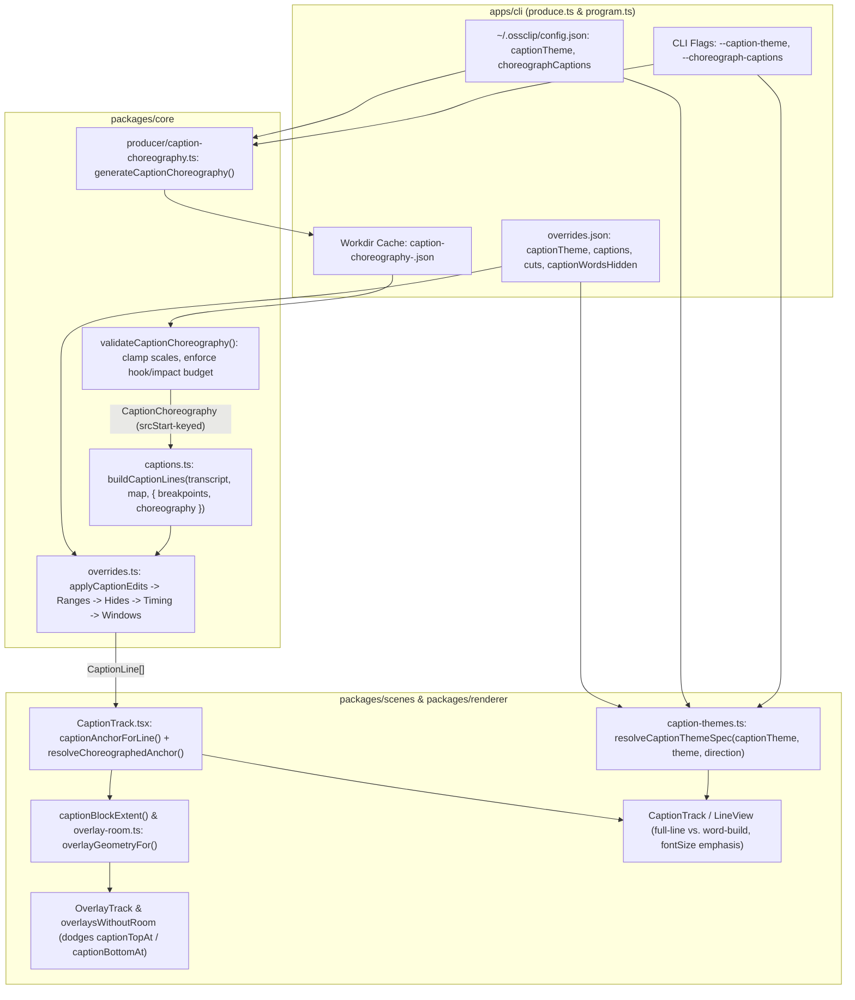

# AI Choreographed Captions & Caption Themes

*   **Author:** Muhammad Ahsan Ayaz
*   **Status:** Approved
*   **Date:** 2026-11-11

--------------------------------------------------------------------------------

## Overview

`ossclip` generates burned-in captions for short-form and long-form videos by packing transcript words into fixed-size lines (3 words over 1.2s in 9:16 portrait; 6 words over 2.4s in 16:9 landscape) and rendering them with a single visual treatment: bold white display type, a black outline, a drop shadow, and an active-word color highlight at a fixed vertical anchor (`y = 0.76`).

This design introduces two orthogonal capabilities across the CLI (`ossclip produce`) and the web editor (`ossclip edit`), gated behind a standalone interactive HTML mock page (`packages/scenes/caption-themes-mock.html`, with zero runtime imports or build impact on `@ossclip/scenes`) for visual verification prior to Remotion integration:

1.  **Caption Themes (`--caption-theme <preset>` / config `captionTheme`)**: A deterministic styling and reveal preset system with five built-in themes (`default`, `founder`, `punch`, `boxed`, `minimal`). Each theme defines typography weight and tracking, background pills or full-line boxes, stroke and shadow treatments, color mappings derived from the active [`Theme`](file:///home/ahsanayaz/code/ossclip/packages/core/src/scene-schema.ts#L276-L291), and word reveal mechanics (`full-line` vs. progressive `word-build`). Caption themes operate without an LLM call.
2.  **AI Caption Choreography (`--choreograph-captions` / config `choreographCaptions`)**: An optional, cached, mechanical-tier LLM pass over the kept transcript words. It groups words into semantic phrases rather than fixed word counts, assigns bounded per-word size multipliers (`1.0x` to `1.4x`) to emphasize hooks or metrics, and tags opening hook chunks (and sparse high-emphasis beats) with `role: "hook" | "impact"` so [`CaptionTrack`](file:///home/ahsanayaz/code/ossclip/packages/scenes/src/CaptionTrack.tsx) places them into clear bands around the speaker's measured [`FaceBox`](file:///home/ahsanayaz/code/ossclip/packages/core/src/face.ts#L21-L32) while keeping main-body captions at a predictable reading anchor.

## The Problem

Viewers on X, Instagram Reels, YouTube Shorts, and LinkedIn frequently watch product launch demos and developer videos on mute. Today's caption pipeline in [`captions.ts`](file:///home/ahsanayaz/code/ossclip/packages/core/src/captions.ts#L244-L314) and [`CaptionTrack.tsx`](file:///home/ahsanayaz/code/ossclip/packages/scenes/src/CaptionTrack.tsx#L540-L610) has three limitations:

1.  **Arbitrary 3-Word Breaks Split Semantic Phrases**: [`buildCaptionLines`](file:///home/ahsanayaz/code/ossclip/packages/core/src/captions.ts#L244-L314) flushes a line as soon as it hits `maxWordsPerLine` (`3` in portrait) or `maxLineDuration` (`1.2s`). A spoken hook such as `"We shipped this in 48 hours"` splits mid-thought into `"We shipped this"` and `"in 48 hours"`, weakening the visual punch of `"48 hours"` and forcing viewers to piece phrases together across flashes.
2.  **Uniform Word Sizing and Static Hook Placement**: Every word in a line renders at the exact same font size (`64px` portrait, `44px` landscape), and every line in a talking-head opening sits at `DEFAULT_CAPTION_ANCHOR` (`0.76`). Creators cannot visually accent the core metric or hook keyword via scale, nor can the opening hook use open headroom above or around the speaker's face to grab attention in the first 3 seconds.
3.  **Single Visual Look**: Creators making raw product demos (such as the builder-style launch videos popularized by HeyClicky) need clean, pill-highlighted or boxed typography without heavy `10px` black strokes, whereas high-energy short-form clips benefit from progressive word build-in and heavy offset shadows. Today, changing [`Theme`](file:///home/ahsanayaz/code/ossclip/packages/core/src/scene-schema.ts#L276-L291) only swaps font family and hex colors (`fg`, `accent`), leaving stroke width, pill backings, and reveal mechanics hardcoded.

The proposed solution decouples **visual styling (`CaptionTheme`)** from **semantic phrasing and spatial staging (`CaptionChoreography`)**, feeding choreography into [`buildCaptionLines`](file:///home/ahsanayaz/code/ossclip/packages/core/src/captions.ts#L244-L314) as source-anchored (`srcStart`) phrase breaks and word metadata so that live cuts, word hiding, and word retyping in `ossclip edit` continue to work deterministically in the browser without calling an LLM.

## Goals

*   **G1 — Pre-Integration Interactive HTML Mock Page**: Deliver a standalone HTML/CSS/JS preview page (`packages/scenes/caption-themes-mock.html`, with zero runtime imports or build impact on `@ossclip/scenes`) that renders all five caption themes (`default`, `founder`, `punch`, `boxed`, `minimal`), both `word-build` strategies (`slot-reserved`, where all word `<span>`s stay mounted for the full line duration with unspoken words at `opacity: 0` so flex positions never shift, vs. `dynamic-reflow`, where only spoken words are laid out and the line re-centers as each word appears), multi-word emphasis sizing (`1.0x`–`1.4x`), Urdu Nastaliq RTL lines, and `FaceBox` safe-zone overlays on 9:16 and 16:9 stages at 30fps before modifying Remotion components.
*   **G2 — Five Deterministic Caption Themes**: Support `--caption-theme <preset>` (`default | founder | punch | boxed | minimal`), `captionTheme` in `~/.ossclip/config.json`, and `captionTheme` in `overrides.json` with strict precedence (`overrides.json > CLI flag > config.json > "default"`), zero LLM dependency, and `command.json` replay pinning.
*   **G3 — Byte-Identical Default Behavior**: When `captionTheme` is omitted or `"default"` and `choreographCaptions` is off, [`buildCaptionLines`](file:///home/ahsanayaz/code/ossclip/packages/core/src/captions.ts#L244-L314) and [`CaptionTrack`](file:///home/ahsanayaz/code/ossclip/packages/scenes/src/CaptionTrack.tsx#L540-L610) must produce byte-identical data structures, DOM attributes, and rendered pixels compared to pre-feature runs.
*   **G4 — Independent, Cached AI Choreography Pass**: Support `--choreograph-captions` / `--no-choreograph-captions` (and config `choreographCaptions`) as a standalone cached LLM pass (`caption-choreography-<hash>.json`) using the mechanical/fast model tier, operable with or without `--produce` scene graphics.
*   **G5 — Deterministic Guardrails & Spatial Stability**: Validate and normalize LLM choreography output (`validateCaptionChoreography`) so transcript text, word order, and word count can never be altered by the LLM; clamp per-word emphasis scales to `[1.0, 1.4]` (max 2 emphasized words per phrase); and attach `role?: "hook" | "impact"` to [`CaptionLine`](file:///home/ahsanayaz/code/ossclip/packages/core/src/captions.ts#L23-L27) so [`CaptionTrack`](file:///home/ahsanayaz/code/ossclip/packages/scenes/src/CaptionTrack.tsx) restricts non-default `FaceBox`-aware safe-zone placement to the opening hook (`t < 4.0s`, max 2 phrases) and rare impact phrases (`<= 2` words, max 1 per 15s) during plain `full-bleed` takes.
*   **G6 — Full Editor & Overlay Geometry Compatibility**: Preserve semantic phrase groupings, per-word `emphasisScale`, and line `role` across editor word retypes (`applyCaptionEdits`), equal-word-count range edits (`applyCaptionRangeEdits`; count-changing range edits preserve `line.role` while minting unscaled replacement words), word hides (`applyCaptionWordHides`), live cuts (`rebuildCaptionTrack`), and [`OverlayTrack`](file:///home/ahsanayaz/code/ossclip/packages/scenes/src/overlay-track.tsx) bounding-box avoidance (`captionBlockExtent` and [`overlayGeometryFor`](file:///home/ahsanayaz/code/ossclip/packages/scenes/src/overlay-room.ts#L21-L35)).
*   **G7 — RTL / Urdu Nastaliq Safety**: Prevent Arabic-script ligature breakage or vertical glyph clipping across all five themes by disabling `uppercase` transforms, negative letter-spacing, and tight vertical pill constraints whenever `lineDirection(text) === "rtl"`.

## Non-Goals

*   **NG1 — Body Segmentation or Depth Matting**: Placing captions behind the speaker's torso or shoulders via per-frame person-segmentation ML models is out of scope; safe-zone placement uses the existing 2D [`FaceBox`](file:///home/ahsanayaz/code/ossclip/packages/core/src/face.ts#L21-L32) cascade detector (`headBand` + `freeBands`).
*   **NG2 — Freeform Canvas Coordinates or Rotated Text**: The LLM will not emit raw X/Y pixel coordinates, arbitrary rotation angles, or multi-axis curved text paths.
*   **NG3 — Browser-Side LLM Calls in `ossclip edit`**: Cutting words, toggling silence removals, or editing text in the web editor will never trigger a live LLM call; all re-packing happens deterministically in the browser from the stored `CaptionChoreography` metadata.
*   **NG4 — Custom User-Authored CSS Theme Files**: v1 ships the five curated presets (`default`, `founder`, `punch`, `boxed`, `minimal`) parameterized by the user's existing [`Theme`](file:///home/ahsanayaz/code/ossclip/packages/core/src/scene-schema.ts#L276-L291) tokens (`fg`, `accent`, `fontDisplay`).

## Open Questions

*   None.

## Critical User Journeys (CUJs)

### CUJ 1: Selecting a Caption Theme Without AI Choreography

*   **Given**: A user has a local video `demo.mp4` and wants clean builder-style pill captions (`founder`) without running AI caption choreography or `--produce` scene graphics.
*   **When**: The user runs `ossclip produce demo.mp4 --caption-theme founder` (or sets `"captionTheme": "founder"` in `~/.ossclip/config.json`).
*   **Then**: `ossclip` validates the preset name via `CaptionThemeIdSchema`, packs captions deterministically using [`buildCaptionLines`](file:///home/ahsanayaz/code/ossclip/packages/core/src/captions.ts#L244-L314), records `"--caption-theme", "founder"` in `command.json` for replay, writes `captionTheme: "founder"` (and `baseCaptionTheme: "founder"` when set via CLI/config) into `render-props.json` and `production.json`, and renders the video with the `founder` preset (weight 800, rounded accent pill on the active word, `2px` outline, dimmed inactive words) with zero LLM choreography calls.

### CUJ 2: Producing a Video with AI Choreographed Captions and a Theme

*   **Given**: A user has a talking-head launch video `launch.mp4` with a measured [`FaceBox`](file:///home/ahsanayaz/code/ossclip/packages/core/src/face.ts#L21-L32) and runs `ossclip produce launch.mp4 --choreograph-captions --caption-theme punch`.
*   **When**: The transcription and automatic silence-cut phases complete.
*   **Then**:
    1.  `ossclip` computes `captionChoreographyCacheKey` over the base-cutlist surviving words (`srcStart` timestamps and text), aspect ratio, provider/model, and prompt version, and invokes `generateCaptionChoreography` on the fast/mechanical LLM tier before `usage.json` is written (unless cached in `caption-choreography-<hash>.json`).
    2.  `validateCaptionChoreography` normalizes the response, ensuring all surviving words are covered in order, clamping `emphasisScale` to `[1.0, 1.4]`, and restricting `role: "hook"` to the first 4.0 output seconds (max 2 phrases) and `role: "impact"` to at most 1 short phrase per 15 output seconds.
    3.  [`buildCaptionLines`](file:///home/ahsanayaz/code/ossclip/packages/core/src/captions.ts#L244-L314) packs words along the semantic phrase breaks while still flushing at any graphic scene `breakpoints`, attaching `emphasisScale` to each [`CaptionWord`](file:///home/ahsanayaz/code/ossclip/packages/core/src/captions.ts#L10-L21) and `role?: "hook" | "impact"` to each [`CaptionLine`](file:///home/ahsanayaz/code/ossclip/packages/core/src/captions.ts#L23-L27).
    4.  [`CaptionTrack`](file:///home/ahsanayaz/code/ossclip/packages/scenes/src/CaptionTrack.tsx#L540-L610) resolves `line.role` at render time via `resolveChoreographedAnchor` to place the opening hook in the clear vertical band above/below the speaker's head (avoiding `headBand(face)`, `SAFE_AREA`, and `sourceTextRegions`), renders emphasized words at `fontSizePx * emphasisScale` without horizontal collision, and reveals words progressively (`word-build`) in the `punch` style while keeping main-body captions anchored at `y = 0.76`.

### CUJ 3: Live Cutting and Word Retyping in `ossclip edit`

*   **Given**: A project produced with `--choreograph-captions --caption-theme boxed` is opened in `ossclip edit`.
*   **When**: The user cuts a sentence in the transcript panel, vetoes a silence removal, hides a filler word, retypes a caption word, or drags a scene's `captionY` slider in the inspector.
*   **Then**:
    1.  `rebuildCaptionTrack` in [`liveCaptionTrack.ts`](file:///home/ahsanayaz/code/ossclip/apps/editor/src/liveCaptionTrack.ts#L113-L147) re-runs [`buildCaptionLines`](file:///home/ahsanayaz/code/ossclip/packages/core/src/captions.ts#L244-L314) in the browser using the stored `captionChoreography` metadata keyed by word `srcStart`.
    2.  Surviving words keep their semantic phrase breaks and `emphasisScale` multipliers; revived gap words outside choreographed phrases pack cleanly with standard unchoreographed limits; hiding a single word via [`applyCaptionWordHides`](file:///home/ahsanayaz/code/ossclip/packages/core/src/overrides.ts#L2283) preserves `line.role`; and any user-set per-scene `captionY` override takes precedence over the choreographed safe-zone anchor.

### CUJ 4: Visually Validating Themes in the Interactive HTML Mock Page

*   **Given**: A developer or creator opens `packages/scenes/caption-themes-mock.html` in a browser before running full video renders.
*   **When**: They switch between `default`, `founder`, `punch`, `boxed`, and `minimal`, toggle between 9:16 portrait and 16:9 landscape, scrub the 30fps timeline, toggle `slot-reserved` vs. `dynamic-reflow` word build-in, and switch to the Urdu Nastaliq RTL sample line.
*   **Then**: The page renders the exact CSS styles, stroke scaling, pill geometry, `FaceBox` head-band overlay, and word-pop easing curves in real time without running a Remotion render.

## Technical Plan (Architecture)

### 1. System Data Flow

The architecture separates **theme preset resolution** (pure styling and reveal mechanics) from **caption choreography** (semantic phrase breaks, per-word size multipliers, and hook/impact role tags). Both feed into [`buildCaptionLines`](file:///home/ahsanayaz/code/ossclip/packages/core/src/captions.ts#L244-L314), [`CaptionTrack`](file:///home/ahsanayaz/code/ossclip/packages/scenes/src/CaptionTrack.tsx#L540-L610), and [`overlayGeometryFor`](file:///home/ahsanayaz/code/ossclip/packages/scenes/src/overlay-room.ts#L21-L35), shared identically between CLI rendering and the browser editor.



### 2. Caption Theme Preset Architecture (`CaptionThemeId` & `CaptionThemeSpec`)

Instead of adding 15 caption-specific CSS properties onto [`ThemeSchema`](file:///home/ahsanayaz/code/ossclip/packages/core/src/scene-schema.ts#L276-L291), caption themes are modeled as a dedicated preset enum in [`captions.ts`](file:///home/ahsanayaz/code/ossclip/packages/core/src/captions.ts) (and re-exported through `@ossclip/core/browser`):

```ts
export const CAPTION_THEME_IDS = [
  "default",
  "founder",
  "punch",
  "boxed",
  "minimal",
] as const;

export const CaptionThemeIdSchema = z.enum(CAPTION_THEME_IDS);
export type CaptionThemeId = z.infer<typeof CaptionThemeIdSchema>;
```

At render time in `@ossclip/scenes`, `resolveCaptionThemeSpec(presetId, theme, direction, fontSizePx)` combines the preset's structural rules with the user's [`Theme`](file:///home/ahsanayaz/code/ossclip/packages/core/src/scene-schema.ts#L276-L291) palette (`theme.fg`, `theme.accent`, `theme.fontDisplay`), the line's bidi direction (`"ltr" | "rtl"`), and the effective base `fontSizePx`:

| Property | `default` | `founder` | `punch` | `boxed` | `minimal` |
| :--- | :--- | :--- | :--- | :--- | :--- |
| **`revealMode`** | `"full-line"` | `"full-line"` | `"word-build"` | `"full-line"` | `"word-build"` |
| **`fontScale`** | `1.0` | `0.92` | `1.08` | `0.95` | `0.84` |
| **`fontWeight`** | `900` | `800` | `900` | `800` | `700` |
| **`textTransform` (LTR)** | `"none"` | `"none"` | `"uppercase"` | `"none"` | `"none"` |
| **`letterSpacing` (LTR)** | `"normal"` | `"-0.02em"` | `"0.01em"` | `"-0.01em"` | `"0.01em"` |
| **`strokeRatio`** (`px` at `64px`) | `10` | `2` | `12` | `0` | `0` |
| **`shadowStyle`** | `0 4px ${(fontSizePx * 24) / 64}px rgba(0,0,0,0.85), 0 1px 0 rgba(0,0,0,0.95)` | `0 3px ${(fontSizePx * 14) / 64}px rgba(0,0,0,0.65)` | `0 ${Math.round((fontSizePx * 6) / 64)}px 0 rgba(0,0,0,0.9)` | `"none"` | `0 2px ${(fontSizePx * 8) / 64}px rgba(0,0,0,0.7), 0 0 ${(fontSizePx * 2) / 64}px rgba(0,0,0,0.85)` |
| **`lineBoxStyle`** | `undefined` | `undefined` | `undefined` | Inner fit-content wrapper: `backgroundColor: "rgba(10, 10, 12, 0.86)"`, `borderRadius: "0.28em"`, `padding: direction === "rtl" ? "0.28em 0.55em" : "0.16em 0.45em"` | `undefined` |
| **`activeWordPill`** | `undefined` | `backgroundColor: theme.accent`, `color: pillTextColorFor(theme.accent)`, `borderRadius: "0.22em"`, `padding: direction === "rtl" ? "0.14em 0.28em" : "0.04em 0.22em"`, `clearStroke: true` | When `(w.emphasisScale ?? 1) >= 1.15`: `backgroundColor: theme.accent`, `color: "#FFFFFF"`, `borderRadius: "0.18em"`, `padding: direction === "rtl" ? "0.14em 0.28em" : "0.04em 0.20em"`, `rotateDeg: direction === "rtl" ? 0 : -1.5`, `clearStroke: false` | `undefined` | `undefined` |
| **`inactiveOpacity`** | `1.0` | `0.85` | `1.0` | `0.92` | `0.60` |
| **`popScaleAmp`** | `0.08` | `0.05` | `0.14` | `0.04` | `0.04` |

*   **Byte-Identical `default` Path**: When `captionTheme` is `undefined` or `"default"` and no word has `emphasisScale !== undefined`, [`LineView`](file:///home/ahsanayaz/code/ossclip/packages/scenes/src/CaptionTrack.tsx#L402-L533) executes the pre-existing byte-identical style branch so existing DOM snapshot and pixel tests remain untouched.
*   **Inner Fit-Content Wrapper for `boxed`**: Because `LineView`'s outer `div` has `left: 0, right: 0` (`100%` width), when `themeSpec.lineBoxStyle` is defined (`boxed`), `LineView` applies `width: "fit-content"`, `maxWidth: `${(1 - safeArea.left - safeArea.right) * 100}%``, `margin: "0 auto"`, and spreads `themeSpec.lineBoxStyle` onto the flex row so the dark rounded pill hugs the caption text instead of spanning the full frame width.
*   **RTL / Nastaliq Guard**: Whenever `direction === "rtl"`, `resolveCaptionThemeSpec` forces `textTransform: "none"`, `letterSpacing: "normal"`, `rotateDeg: 0`, and uses the expanded RTL vertical pill/box padding above so `Noto Nastaliq Urdu` diagonal glyph stacks (`lineHeight: 1.9`) are never clipped or disconnected.

### 3. Source-Anchored AI Choreography Model (`CaptionChoreography`)

To survive browser-side recuts in `ossclip edit` without calling an LLM in the browser, the LLM choreography pass is converted into a source-anchored data structure (`CaptionChoreography`) stored in `production.json` (for `--scenes` editor Render replay carry-forward via `priorCaptionChoreography`) and `render-props.json` (for browser editor live preview):

```ts
/**
 * Canonical source-timestamp key for a caption word ("w<ms>").
 * Defined in packages/core/src/captions.ts and re-exported by overrides.ts
 * to avoid a circular dependency between captions.ts and overrides.ts.
 */
export function captionKeyFor(srcStart: number): string {
  return `w${Math.round(srcStart * 1000)}`;
}

export const CaptionPhraseRoleSchema = z.enum(["hook", "body", "impact"]);
export type CaptionPhraseRole = z.infer<typeof CaptionPhraseRoleSchema>;

export const CaptionChoreographyWordSchema = z.object({
  /** Emphasis font-size multiplier, clamped to [1.0, 1.4]. Omit when 1.0. */
  emphasisScale: z.number().min(1).max(1.4).optional(),
});

export const CaptionChoreographyPhraseSchema = z.object({
  /** Source timestamp (srcStart) of the first word in this semantic phrase. */
  startSrcSec: z.number().finite().nonnegative(),
  /** Source timestamp (srcStart) of the last word in this semantic phrase. */
  endSrcSec: z.number().finite().nonnegative(),
  /** Semantic staging role; defaults to "body". */
  role: CaptionPhraseRoleSchema.optional(),
});

export const CaptionChoreographySchema = z.object({
  phrases: z.array(CaptionChoreographyPhraseSchema),
  /** Keyed by captionKeyFor(w.srcStart) ("w<ms>"), matching OverrideDoc.captions. */
  words: z.record(z.string(), CaptionChoreographyWordSchema).default({}),
});
export type CaptionChoreography = z.infer<typeof CaptionChoreographySchema>;
```

#### How `generateCaptionChoreography` and `validateCaptionChoreography` Work

1.  **Dual-Clock Input Words, Prompt Format & Mechanical Tier**:
    *   `generateCaptionChoreography` and `validateCaptionChoreography` accept mapped surviving words carrying both output clock timestamps (`start`, `end`, starting from `0.0s` even on `--clip` runs) and source clock `srcStart`: `export interface ChoreographyInputWord { text: string; start: number; end: number; srcStart: number }`.
    *   `buildCaptionChoreographyPrompt(words, aspect)` formats each word as `[${i}|${w.start.toFixed(2)}s] ${w.text}` (matching `/\[(\d+)\|/g` used by [`MockProvider`](file:///home/ahsanayaz/code/ossclip/packages/core/src/producer/mock.ts#L28) so mock runs extract valid in-bounds word indices regardless of transcript length).
    *   `generateCaptionChoreography` calls `provider.complete({ tier: "mechanical", schema: RawChoreographyLlmSchema, schemaName: "caption_choreography" })`. The LLM returns contiguous word index ranges `[startWord, endWord]`, optional phrase `role` (`"hook" | "body" | "impact"`), and optional word emphasis entries `{ word: number, scale: number }`.
2.  **Deterministic Validator (`validateCaptionChoreography`)**:
    *   **Full Coverage Without Word Mutation**: The validator walks the input words `0 .. N-1` in order. Any gap, overlap, or out-of-range index in the LLM's phrase ranges is repaired by partitioning uncovered spans with the default greedy word packer (`maxWordsPerLine`: 3 portrait / 6 landscape). The LLM never emits word strings, so it cannot hallucinate or drop transcript text.
    *   **Phrase Length Ceiling**: Any LLM phrase exceeding `maxChoreographedWords` (`5` in portrait, `8` in landscape) or spanning an output speech pause `w[i].start - w[i-1].end > maxGap` (`0.6s`) is split deterministically.
    *   **Emphasis Budget & Tie-Breaking**: Per-word `scale` is clamped to `[1.0, 1.4]` (rounded to 2 decimals). Candidate emphasis entries with `scale > 1.05` are sorted deterministically by `scale` descending, then `word` index ascending. At most 2 words per phrase and at most `Math.max(1, Math.floor(words.length * 0.25))` words across the transcript are kept; lower-ranked entries are dropped.
    *   **Spatial Stability Budget (Evaluated on Output Clock `w.start`)**:
        *   `role: "hook"` is permitted only on phrases whose first word has output `start < 4.0` seconds (at most the first 2 phrases). Any later phrase tagged `"hook"` is downgraded to `"body"`.
        *   `role: "impact"` is permitted only on phrases of `<= 2` words with at least one emphasized word (`>= 1.15x`), spaced at least `15.0` output seconds after the previous `"impact"` phrase's `end`. Any other `"impact"` tag is downgraded to `"body"`.
    *   **Source-Time Conversion**: Validated word index ranges `[startWord, endWord]` are converted into `CaptionChoreography` (`startSrcSec: words[startWord].srcStart`, `endSrcSec: words[endWord].srcStart`, and `words[captionKeyFor(w.srcStart)]`) so the artifact is immune to subsequent timeline cuts.

#### How `buildCaptionLines` Consumes `CaptionChoreography`

[`CaptionWord`](file:///home/ahsanayaz/code/ossclip/packages/core/src/captions.ts#L10-L21), [`CaptionLine`](file:///home/ahsanayaz/code/ossclip/packages/core/src/captions.ts#L23-L27), [`CaptionOptions`](file:///home/ahsanayaz/code/ossclip/packages/core/src/captions.ts#L120-L135), and [`captionPackingFor`](file:///home/ahsanayaz/code/ossclip/packages/core/src/captions.ts#L235-L254) gain optional fields (omitted on `CaptionWord` / `CaptionLine` when absent so unchoreographed runs remain byte-identical):

```ts
export interface CaptionWord {
  text: string;
  start: number;
  end: number;
  srcStart: number;
  /** Per-word font-size multiplier from AI choreography (1.0..1.4). */
  emphasisScale?: number;
}

export interface CaptionLine {
  words: CaptionWord[];
  start: number;
  end: number;
  /** Semantic role from AI choreography; absent on unchoreographed lines. */
  role?: CaptionPhraseRole;
}

export interface CaptionOptions {
  maxWordsPerLine?: number;
  maxLineDuration?: number;
  maxGap?: number;
  hold?: number;
  breakpoints?: number[];
  choreography?: CaptionChoreography;
  /** Safety word ceiling per choreographed phrase (defaults to 5 portrait, 8 landscape). */
  maxChoreographedWords?: number;
  /** Safety duration ceiling per choreographed phrase in seconds (defaults to 2.2s portrait, 3.2s landscape). */
  maxChoreographedDuration?: number;
}
```

*   `captionPackingFor(landscape)` returns `{ maxWordsPerLine: 3, maxLineDuration: 1.2, maxChoreographedWords: 5, maxChoreographedDuration: 2.2 }` when `landscape === false` and `{ maxWordsPerLine: 6, maxLineDuration: 2.4, maxChoreographedWords: 8, maxChoreographedDuration: 3.2 }` when `landscape === true`.
*   When `opts.choreography` is passed to [`buildCaptionLines`](file:///home/ahsanayaz/code/ossclip/packages/core/src/captions.ts#L244-L314):
    1.  Each mapped `CaptionWord` looks up `const scale = choreography.words[captionKeyFor(w.srcStart)]?.emphasisScale` and attaches `emphasisScale: scale` when `scale !== undefined && scale > 1`.
    2.  A word `w` matches a phrase `p` in `choreography.phrases` iff `w.srcStart >= p.startSrcSec - 1e-6 && w.srcStart <= p.endSrcSec + 1e-6` (`phraseIndexForWord(w.srcStart, choreography.phrases)` returning the phrase index `>= 0` or `-1` for revived gap words).
    3.  The current line flushes whenever:
        *   The phrase index changes between the current line's words and the incoming word `w` (`currentPhraseIdx !== nextPhraseIdx`, handling both exiting a choreographed phrase and transitioning from an unchoreographed revived gap into the next choreographed phrase), OR
        *   A scene `breakpoint` or `maxGap` (`0.6s`) is crossed, OR
        *   The active limit is reached: when `currentPhraseIdx >= 0`, use `maxChoreographedWords` (`5` portrait / `8` landscape) and `maxChoreographedDuration` (`2.2s` portrait / `3.2s` landscape); when `currentPhraseIdx === -1` (unchoreographed revived words), use standard `maxWordsPerLine` (`3` / `6`) and `maxLineDuration` (`1.2s` / `2.4s`).
    4.  **Role Assignment on Split Phrases**:
        *   If a choreographed phrase has `role === "hook"` and is flushed (even if split across multiple lines by `breakpoints`, `maxGap`, or the safety ceiling), only the **first** flushed sub-line of that phrase receives `role: "hook"` (provided it was not split by a graphic scene breakpoint); subsequent sub-lines of that phrase receive `role: undefined`.
        *   If a choreographed phrase has `role === "impact"`, it receives `role: "impact"` only if all surviving words in that phrase flushed as a single unsplit line; if split, `role` is dropped (`undefined`).

### 4. FaceBox-Aware Safe-Zone Placement & Overlay Collision Geometry

In [`CaptionTrack.tsx`](file:///home/ahsanayaz/code/ossclip/packages/scenes/src/CaptionTrack.tsx#L196-L216), `captionAnchorForLine` determines `{ anchor, scale }` for each line:

1.  **Precedence Ladder**:
    *   **Priority 1 (User Per-Scene Override)**: If `activeCue?.captionY !== undefined`, return `activeCue.captionY` directly.
    *   **Priority 2 (Choreographed `"hook"` or `"impact"` Line)**: If `line.role === "hook" || line.role === "impact"`, call `resolveChoreographedAnchor(line, activeCue, face, sourceTextRegions, frame, watermark)`:
        *   **Eligibility Guard**: Requires `face != null && face.subject !== "screen"` AND `(activeCue === null || (activeCue.kind === "plain" && activeCue.layout === "full-bleed"))`. This ensures graphic cues that use `FULL_BLEED_GRAPHIC_SLOT` (`y: 0.24, h: 0.36`, where `activeCue.kind !== "plain"` and `activeCue.layout === "full-bleed"`) and unmeasured/screen subjects always fall through to Priority 3.
        *   **Head Band in Frame Fractions**: Normalize `const normalizedFace = { centerYFrac: face.centerYFrac, sizeFrac: face.sizeFrac ?? DEFAULT_FACE.sizeFrac }` and compute `const head = headBand(normalizedFace)` ([`stage.ts:452`](file:///home/ahsanayaz/code/ossclip/packages/scenes/src/stage.ts#L452-L457)), which directly yields `{ start, end }` in `[0, 1]` frame fractions (matching [`coverTextRect` in `stage.ts:484`](file:///home/ahsanayaz/code/ossclip/packages/scenes/src/stage.ts#L484-L485)).
        *   **Blocked Intervals**: Collect all blocked vertical intervals during `[line.start, line.end]`: `head` (`{ start: head.start, end: head.end }`), `regionsDuring(sourceTextRegions, line.start, line.end)` mapped to `{ start: r.y, end: r.y + r.h }`, and (when `watermark === true`) the top watermark band `{ start: safe.top, end: safe.top + 0.06 }`.
        *   Run `freeBands({ start: safe.top, end: 1 - safe.bottom }, blocked)` ([`stage.ts:421`](file:///home/ahsanayaz/code/ossclip/packages/scenes/src/stage.ts#L421-L438)).
        *   For `"hook"`, if an upper free band ending at or above `head.start` (`band.end <= head.start + 1e-4`) has height `band.end - band.start >= MIN_HOOK_BAND_H` (`0.14`), return its center `(band.start + band.end) / 2` clamped to `[safe.top + 0.06, 1 - safe.bottom - 0.06]`. Otherwise, select the tallest free band below `head.end` (`band.start >= head.end - 1e-4`) with height `>= MIN_HOOK_BAND_H` and return its center. If no band qualifies, fall through to Priority 3.
    *   **Priority 3 (Standard Main-Body Anchor)**: Fall through to today's `captionAnchorAvoiding(...)` (`0.76` in portrait `full-bleed`).
2.  **Emphasis-Aware Bounding Box for `OverlayTrack` and `overlayGeometryFor`**:
    *   [`estimateCaptionRows`](file:///home/ahsanayaz/code/ossclip/packages/scenes/src/CaptionTrack.tsx#L256-L274) and [`captionBlockExtent`](file:///home/ahsanayaz/code/ossclip/packages/scenes/src/CaptionTrack.tsx#L293-L309) multiply each word's estimated advance width by `w.emphasisScale ?? 1` and the line's row height by `max(w.emphasisScale ?? 1) * themeSpec.fontScale`.
    *   In [`packages/scenes/src/overlay-room.ts`](file:///home/ahsanayaz/code/ossclip/packages/scenes/src/overlay-room.ts#L21-L35), `overlayGeometryFor` adds `captionTheme?: CaptionThemeId` and `watermark?: boolean` to its options (`face?: FacePoint | null` is already present at line 25) and forwards `{ captionTheme: opts.captionTheme, face: opts.face, watermark: opts.watermark }` into `captionTopAtFor` and `captionBottomAtFor`. All three callers of `overlayGeometryFor` ([`ProductionComposition.tsx:306`](file:///home/ahsanayaz/code/ossclip/packages/renderer/src/ProductionComposition.tsx#L306-L313), [`produce.ts:4888`](file:///home/ahsanayaz/code/ossclip/apps/cli/src/produce.ts#L4888-L4894), and [`App.tsx:1732`](file:///home/ahsanayaz/code/ossclip/apps/editor/src/App.tsx#L1732-L1738)) pass `captionTheme`, `face`, and `watermark` so `OverlayTrack` and `overlaysWithoutRoom` agree in CLI and editor.

### 5. Spatial vs. Temporal Word Sizing and Progressive `word-build` in `LineView`

Inside [`LineView`](file:///home/ahsanayaz/code/ossclip/packages/scenes/src/CaptionTrack.tsx#L402-L533):
*   **Per-Word Emphasis (`fontSize`)**: A word with `w.emphasisScale` sets `` fontSize: `${w.emphasisScale}em` `` (or `Math.round(fontSizePx * (w.emphasisScale ?? 1))`) and `lineHeight: 1.05` inside the flex row (`alignItems: "baseline"`). This allocates real horizontal and vertical layout space once when the `<Sequence>` mounts, preventing enlarged words from overlapping neighbors.
*   **Per-Frame Active Pop (`transform: scale()`)**: The frame-driven active pop (`1 + themeSpec.popScaleAmp * pop`) stays on `style.transform`, avoiding per-frame layout reflows.
*   **Progressive `word-build` Reveal**: When `themeSpec.revealMode === "word-build"`, all word `<span>`s in `line.words` remain mounted for the full `<Sequence>` (`slot-reserved`, so flex layout coordinates and editor `data-caption-src` DOM hit-targets never shift mid-line). For unspoken words (`t < w.start`), `opacity` is `0` and `transform` holds `translateY(6px) scale(0.92)`, ramping to `opacity: 1` (or `themeSpec.inactiveOpacity` once `t >= w.end`) and the active pop over `CAPTION_POP_SEC` (`0.12s`) as `t` crosses `w.start`.

### 6. CLI Flags, Config, Overrides, and Cache Key

1.  **CLI Flags in [`program.ts`](file:///home/ahsanayaz/code/ossclip/apps/cli/src/program.ts)**:
    *   `--caption-theme <preset>`: Validated at parse time via `CaptionThemeIdSchema.safeParse`; throws `InvalidArgumentError` listing `default, founder, punch, boxed, minimal` on unknown input.
    *   `--choreograph-captions` / `--no-choreograph-captions`: Tri-state boolean pair (positive declared first so commander's default is `undefined`, matching `--watermark` and `--cover-in-video`).
2.  **Config, Overrides, and Single Precedence Resolver**:
    *   [`OssclipConfig`](file:///home/ahsanayaz/code/ossclip/packages/core/src/config.ts#L11-L240) adds `captionTheme?: string` and `choreographCaptions?: boolean` (copied in `resolveConfig`).
    *   [`OverrideDocSchema`](file:///home/ahsanayaz/code/ossclip/packages/core/src/overrides.ts#L552) adds `captionTheme: CaptionThemeIdSchema.optional()`.
    *   In [`apps/cli/src/produce.ts`](file:///home/ahsanayaz/code/ossclip/apps/cli/src/produce.ts), `resolveProductionCaptionTheme(overrideTheme, cliFlag, configVal)` resolves `overrides.json > CLI flag > config.json > "default"` (logging a `⚠` warning and falling back to `"default"` if `config.json` contains an invalid string, matching [`resolveProductionColorGrade`](file:///home/ahsanayaz/code/ossclip/apps/cli/src/produce.ts#L1035-L1063)), and `resolveChoreographCaptions(cliFlag, configVal)` resolves `CLI flag > config.json > false`.
    *   [`applyCaptionWordHides`](file:///home/ahsanayaz/code/ossclip/packages/core/src/overrides.ts#L2283) is updated from `out.push({ words: kept, start, end })` to `out.push({ ...line, words: kept, start, end })` so `line.role` survives word hiding.
3.  **Workdir Cache Key (`captionChoreographyCacheKey`) & Replay Lifecycle**:
    *   Stored at `<workdir>/caption-choreography-<12-char-sha256>.json`.
    *   Runs in [`produce.ts`](file:///home/ahsanayaz/code/ossclip/apps/cli/src/produce.ts) **before** `usage.json` is written (line 3902) and **before** user `overrideDoc.cuts` / `overrideDoc.cleanup` overrides are applied, operating over the base-cutlist surviving words (`const planCut = cutWordIndices(transcript.words, cutlist);`).
    *   Hashes `{ version: CAPTION_CHOREOGRAPHY_PROMPT_VERSION, aspect, provider: actualProviderName, model: fastModel, words: baseSurvivingWords.map(w => ({ text: w.text, srcStart: Math.round(w.start * 1000) })) }`. Because the key depends on base-cutlist `srcStart` timestamps rather than post-override output timestamps, user cuts in `ossclip edit` never bust the cache.
    *   When `opts.scenes` is set (editor Render button replay), `produce.ts` does not instantiate an LLM provider or make network calls; it carries `priorCaptionChoreography(work)` forward from `production.json` (or reads the workdir cache) just like `priorSfxPlan(work)` and `priorOverlayPlan(work)`.

## Alternatives Considered

### Alternative A: Per-Frame Body Segmentation for Placing Captions Around or Behind the Speaker's Torso

*   **Pros**: Allows placing large kinetic display text partially behind the speaker's shoulders or wrapping text tightly around body contours.
*   **Cons**: [`ossclip`](file:///home/ahsanayaz/code/ossclip/packages/core/src/face.ts) only computes a static 2D [`FaceBox`](file:///home/ahsanayaz/code/ossclip/packages/core/src/face.ts#L21-L32) via the pure-JS `pico` cascade (`measureFace` / `measureFaceInWindows`). Depth-matting captions behind a torso requires bundling a person-segmentation ML model, running inference per video frame, and compositing alpha masks in Remotion, increasing render time and package size.
*   **Reason for Rejection**: `FaceBox`-derived safe zones (`headBand` + `freeBands`) already locate clear vertical space around the speaker's head for the opening hook without requiring a segmentation model.

### Alternative B: Merging Caption Choreography into the `--produce` Beat-Sheet LLM Call

*   **Pros**: Avoids a separate LLM request when `--produce` is already running.
*   **Cons**: Users frequently run `ossclip produce` without `--produce` (captions-only cuts without code-rendered scene graphics). Furthermore, the beat-sheet call runs on the editorial model tier (which has tight timeout budgets on providers like `antigravity`), whereas grouping words into semantic phrases is a mechanical task suited for the fast model tier (`DEFAULT_FAST_MODEL`).
*   **Reason for Rejection**: Keeping `--choreograph-captions` as its own independent, cached LLM pass allows it to work with or without `--produce` and scale cleanly to editor workflows.

### Alternative C: Replacing `buildCaptionLines` with Pre-Baked LLM `CaptionLine[]` in `render-props.json`

*   **Pros**: Simpler initial CLI implementation because `produce.ts` writes the LLM's grouped lines directly to `render-props.json` without changing [`buildCaptionLines`](file:///home/ahsanayaz/code/ossclip/packages/core/src/captions.ts#L244-L314).
*   **Cons**: Whenever a user makes a cut or toggles a silence removal in `ossclip edit`, [`rebuildCaptionTrack`](file:///home/ahsanayaz/code/ossclip/apps/editor/src/liveCaptionTrack.ts#L113-L147) re-runs [`buildCaptionLines`](file:///home/ahsanayaz/code/ossclip/packages/core/src/captions.ts#L244-L314) in the browser. Pre-baked lines in `render-props.json` would be discarded on the first cut, losing all semantic phrase breaks, word emphasis scales, and `captionLineTiming` keys.
*   **Reason for Rejection**: Storing choreography as source-anchored (`srcStart`) phrase break timestamps and word metadata consumed by [`buildCaptionLines`](file:///home/ahsanayaz/code/ossclip/packages/core/src/captions.ts#L244-L314) preserves choreography across live editor cuts without a browser LLM call.

--------------------------------------------------------------------------------

## Risks & Mitigations

*   **Risk 1 — Preview-vs-Render Choreography Drift After Editor Cuts**: If editor cuts or silence-removal vetoes altered the choreography cache key or triggered a fresh LLM call on Render, the rendered video's phrase breaks and `captionLineTiming` anchors would diverge from the browser preview.
    *   *Mitigation*: `generateCaptionChoreography` runs on base-cutlist words keyed by source `srcStart` prior to user overrides, is persisted in `production.json`, and is carried forward via `priorCaptionChoreography(work)` on `--scenes` replay with zero LLM calls. Revived gap words outside choreographed phrases are packed deterministically using standard unchoreographed limits.
*   **Risk 2 — Static `FaceBox` vs. Speaker Movement or Graphic Full-Bleed Cues**: Placing a hook caption above or below a speaker when no face was detected, when the subject is a screen recording, or when a `full-bleed` graphic cue occupies `FULL_BLEED_GRAPHIC_SLOT` (`y: 0.24, h: 0.36`) could obscure key visual content.
    *   *Mitigation*: `resolveChoreographedAnchor` requires a non-null measured `face` (`face != null && face.subject !== "screen"`) and gates eligibility on `activeCue === null || (activeCue.kind === "plain" && activeCue.layout === "full-bleed")`, leveraging `headBand`'s built-in `HEAD_TOP_MARGIN` (`0.85`) and `CHIN_BOTTOM_MARGIN` (`0.65`) buffers and falling back to `captionAnchorAvoiding` (`0.76`) whenever no band `>= 0.14` frame height is clear.
*   **Risk 3 — Line Wrapping & Overlay Collisions Under Compounded Scales**: A 5-word portrait line with `punch` (`fontScale: 1.08`, `uppercase`) and two `1.4x` emphasized words increases horizontal row wrap count and vertical block height, risking collision with `OverlayTrack` badges.
    *   *Mitigation*: `estimateCaptionRows` weights each word's advance width by `w.emphasisScale ?? 1` (and `1.12x` for `uppercase`), `captionBlockExtent` scales row height by `max(w.emphasisScale ?? 1) * themeSpec.fontScale`, and all three `overlayGeometryFor` call sites (`ProductionComposition.tsx`, `produce.ts`, and `App.tsx`) receive `captionTheme`, `face`, and `watermark`.
*   **Risk 4 — `Noto Nastaliq Urdu` RTL Ascender/Descender Clipping in Pills and Boxes**: Arabic/Urdu Nastaliq script stacks glyphs diagonally up to `2.5x` the nominal em box, which tight LTR pill padding or negative letter-spacing can clip or disconnect.
    *   *Mitigation*: Whenever `lineDirection(text) === "rtl"`, `resolveCaptionThemeSpec` forces `textTransform: "none"`, `letterSpacing: "normal"`, `rotateDeg: 0`, and expanded vertical padding (`0.28em` on `boxed`, `0.14em` on `activeWordPill`).

## Non-Functional Requirements

*   **Performance & LLM Token Economics**:
    *   `--caption-theme` alone makes zero network or LLM calls and adds negligible CPU overhead (`< 1ms` per render).
    *   `--choreograph-captions` uses `tier: "mechanical"` (`DEFAULT_FAST_MODEL`: Haiku 4.5 / Gemini Flash Lite / `gemini-flash-low`). For a 90-second clip (~220 words), the compact indexed word prompt uses ~800 input tokens and ~400 output tokens, cached by SHA-256 in `<workdir>/caption-choreography-<hash>.json`.
    *   Per-word `emphasisScale` is applied via `fontSize` (layout once per `<Sequence>`) while per-frame pop animation stays on `transform: scale()`, avoiding per-frame DOM reflows in Chromium during Remotion frame capture.
*   **Backward Compatibility & Rollback**:
    *   All new fields in `production.json`, `render-props.json`, `overrides.json`, and `config.json` (`captionTheme`, `baseCaptionTheme`, `captionChoreography`, `CaptionWord.emphasisScale`, `CaptionLine.role`) are optional (`undefined` when absent).
    *   Pre-existing `render-props.json` and `overrides.json` files parse and render byte-identically without migration.
    *   If the LLM choreography call fails or times out, `produce` logs a single `⚠` warning and falls back to standard deterministic [`buildCaptionLines`](file:///home/ahsanayaz/code/ossclip/packages/core/src/captions.ts#L244-L314) packing rather than aborting the video render.

--------------------------------------------------------------------------------

## Additional Resources

*   [`packages/core/src/captions.ts`](file:///home/ahsanayaz/code/ossclip/packages/core/src/captions.ts) — Current caption word/line packer, `MAX_CAPTION_WORD_LEAD_SEC`, `MIN_CAPTION_LINE_DWELL_SEC`, and `Nastaliq` RTL helpers.
*   [`packages/scenes/src/CaptionTrack.tsx`](file:///home/ahsanayaz/code/ossclip/packages/scenes/src/CaptionTrack.tsx) — Current Remotion caption renderer, `captionAnchorForLine`, and `captionBlockExtent`.
*   [`packages/scenes/src/stage.ts`](file:///home/ahsanayaz/code/ossclip/packages/scenes/src/stage.ts) — `headBand(face)` and `freeBands` geometry solver.
*   [`packages/scenes/src/overlay-room.ts`](file:///home/ahsanayaz/code/ossclip/packages/scenes/src/overlay-room.ts) — `overlayGeometryFor` and `overlaysWithoutRoom` collision solver.
*   [`apps/editor/src/liveCaptionTrack.ts`](file:///home/ahsanayaz/code/ossclip/apps/editor/src/liveCaptionTrack.ts) — Browser-side live caption re-packer for `ossclip edit`.
*   Y Combinator / Farza Majeed Launch Video Breakdown (`https://www.youtube.com/watch?v=v12aSIZIXUs`) — Inspiration for the `founder` preset's high-contrast, low-clutter keyword emphasis.

## Future Improvements

*   **Editor Inspector Theme Switcher & Per-Word Emphasis Slider**: Expose a dropdown in the `ossclip edit` top bar or inspector to switch `overrides.json.captionTheme` live in the browser Player, and allow clicking a word in the transcript panel to adjust its `emphasisScale` manually.

--------------------------------------------------------------------------------

## Detailed Implementation Plan

### Target Files to Create/Modify

#### 1. [`packages/scenes/caption-themes-mock.html`](file:///home/ahsanayaz/code/ossclip/packages/scenes/caption-themes-mock.html) (Create)

*   **Type / Scope**: Standalone Interactive HTML/CSS/JS Visual Verification Page (Stage 1 Gate; zero runtime imports or build impact on `@ossclip/scenes`).
*   **Rationale**: Allows visual inspection and tuning of all five caption themes, both `word-build` modes (`slot-reserved` vs. `dynamic-reflow`), multi-word emphasis sizing, Urdu Nastaliq RTL rendering, and `FaceBox` hook safe-zone placement on 9:16 and 16:9 stages before modifying Remotion components.
*   **Proposed Changes**:
    *   Create a self-contained HTML page with interactive controls for:
        1.  Preset selector (`default`, `founder`, `punch`, `boxed`, `minimal`) + side-by-side comparison mode.
        2.  Aspect ratio toggle (`9:16 Portrait` vs. `16:9 Landscape`).
        3.  Word-build strategy toggle (`slot-reserved` vs. `dynamic-reflow`).
        4.  Choreography & Safe-Zone overlay toggle showing `SAFE_AREA`, simulated `FaceBox`, `headBand(face)`, and upper hook placement (`y = 0.22`) vs. body anchor (`y = 0.76`).
        5.  Sample phrase switcher: Launch Hook with `1.35x` emphasis (`"We shipped HeyClicky in 48 HOURS"`), CTA Keyword (`"Comment \"AGENTS\" below"`), and code-switched Urdu Nastaliq RTL (`"2026 میں Fulfillment کے نئے اصول"`).
        6.  30fps playback loop and frame scrubber driving the `easeOutQuad` pop and progressive word reveal.

#### 2. [`packages/core/src/captions.ts`](file:///home/ahsanayaz/code/ossclip/packages/core/src/captions.ts) (Modify)

*   **Type / Scope**: Core Browser-Safe Caption Schemas, Key Helper, and Line Packer (`@ossclip/core`).
*   **Rationale**: Defines `captionKeyFor(srcStart)`, the canonical browser-safe schemas (`CaptionThemeIdSchema`, `CaptionPhraseRoleSchema`, `CaptionChoreographySchema`), and updates [`buildCaptionLines`](file:///home/ahsanayaz/code/ossclip/packages/core/src/captions.ts#L244-L314) so both CLI `produce` and browser `ossclip edit` pack semantic phrases, revived gap words, and word emphasis identically without circular imports.
*   **Proposed Changes**:
    *   Define and export `captionKeyFor(srcStart: number): string` returning `` `w${Math.round(srcStart * 1000)}` ``.
    *   Export `CAPTION_THEME_IDS`, `CaptionThemeIdSchema`, `CaptionThemeId`, `CaptionPhraseRoleSchema`, `CaptionPhraseRole`, `CaptionChoreographyWordSchema`, `CaptionChoreographyPhraseSchema`, `CaptionChoreographySchema`, and `CaptionChoreography`.
    *   Extend [`CaptionWord`](file:///home/ahsanayaz/code/ossclip/packages/core/src/captions.ts#L10-L21) with optional `emphasisScale?: number` and [`CaptionLine`](file:///home/ahsanayaz/code/ossclip/packages/core/src/captions.ts#L23-L27) with optional `role?: CaptionPhraseRole`.
    *   Extend [`CaptionOptions`](file:///home/ahsanayaz/code/ossclip/packages/core/src/captions.ts#L120-L135) with optional `choreography?: CaptionChoreography`, `maxChoreographedWords?: number`, and `maxChoreographedDuration?: number`, and update `captionPackingFor(landscape)` to include `maxChoreographedWords: landscape ? 8 : 5` and `maxChoreographedDuration: landscape ? 3.2 : 2.2`.
    *   In [`buildCaptionLines`](file:///home/ahsanayaz/code/ossclip/packages/core/src/captions.ts#L244-L314), when `opts.choreography` is provided:
        *   Attach `emphasisScale` to each mapped word via `choreography.words[captionKeyFor(w.srcStart)]?.emphasisScale` (only when `> 1`).
        *   Match each word `w` against `choreography.phrases` via `w.srcStart >= p.startSrcSec - 1e-6 && w.srcStart <= p.endSrcSec + 1e-6` (`phraseIdx >= 0`, or `-1` for revived gap words).
        *   Flush the current line when `phraseIdx` changes (`currentPhraseIdx !== nextPhraseIdx`), or when `breakpoints`, `maxGap`, or the active limit is reached (`maxChoreographedWords` / `maxChoreographedDuration` when `currentPhraseIdx >= 0`; `maxWordsPerLine` / `maxLineDuration` when `currentPhraseIdx === -1`).
        *   Assign `line.role = "hook"` only on the first flushed sub-line of a `"hook"` phrase (when not split by a graphic scene breakpoint), and `line.role = "impact"` only when an `"impact"` phrase flushes as a single unsplit line.
        *   Keep output byte-identical when `opts.choreography` is `undefined`.

#### 3. [`packages/core/src/producer/caption-choreography.ts`](file:///home/ahsanayaz/code/ossclip/packages/core/src/producer/caption-choreography.ts) (Create)

*   **Type / Scope**: Mechanical-Tier LLM Choreography Generator and Deterministic Validator (`@ossclip/core`).
*   **Rationale**: Implements the standalone LLM pass (`generateCaptionChoreography`) and the deterministic normalization pass (`validateCaptionChoreography`) that guarantees word preservation, emphasis bounds, and spatial stability.
*   **Proposed Changes**:
    *   Define `CAPTION_CHOREOGRAPHY_PROMPT_VERSION = 1`.
    *   Define `ChoreographyInputWord` (`{ text: string; start: number; end: number; srcStart: number }`).
    *   Define `RawChoreographyLlmSchema` accepting `phrases: Array<{ startWord: number, endWord: number, role?: "hook" | "body" | "impact" }>` and `emphasis: Array<{ word: number, scale: number }>`.
    *   Implement `buildCaptionChoreographyPrompt(words, aspect)` formatting each word as `[${i}|${w.start.toFixed(2)}s] ${w.text}` and instructing the model to group words into semantic phrases (1–5 words portrait, 2–7 words landscape), tag at most the opening 1–2 phrases (`< 4.0s`) as `"hook"`, tag rare 1–2 word punchlines as `"impact"`, and accent key metrics/nouns with `scale` (`1.15`–`1.35`).
    *   Implement `validateCaptionChoreography(raw, words, opts)`:
        *   Walks `0 .. words.length - 1` monotonically, repairing any gaps, overlaps, or over-length phrases (`> maxChoreographedWords` or output gap `> maxGap`) with default packing so every input word is covered once in order.
        *   Clamps `scale` to `[1.0, 1.4]` (rounded to 2 decimals), sorts candidates with `scale > 1.05` by `scale` descending then `word` index ascending, and limits emphasized words to at most 2 per phrase and `Math.max(1, Math.floor(words.length * 0.25))` total words.
        *   Enforces the spatial budget on output timestamps `w.start` / `w.end` (`"hook"` only when `words[startWord].start < 4.0` and within first 2 phrases; `"impact"` only on `<= 2`-word phrases with an emphasized word `>= 1.15x` spaced `>= 15.0s` apart).
        *   Converts word indices into `CaptionChoreography` (`startSrcSec: words[startWord].srcStart`, `endSrcSec: words[endWord].srcStart`, and `words[captionKeyFor(w.srcStart)]`).
    *   Implement `generateCaptionChoreography(provider, args)` calling `provider.complete({ tier: "mechanical", schema: RawChoreographyLlmSchema, schemaName: "caption_choreography" })`.

#### 4. [`packages/core/src/producer/mock.ts`](file:///home/ahsanayaz/code/ossclip/packages/core/src/producer/mock.ts) (Modify)

*   **Type / Scope**: Mock LLM Provider (`@ossclip/core`).
*   **Rationale**: Allows `--llm mock --choreograph-captions` in CLI tests and offline runs to return deterministic choreography without network access.
*   **Proposed Changes**:
    *   Add a branch for `opts.schemaName === "caption_choreography"` that extracts word indices from `prompt` via `/\[(\d+)\|/g` (matching the existing `repair_transcript` mock pattern at line 28) and returns deterministic in-bounds `phrases` (first phrase marked `"hook"`) and `emphasis` (first content word scaled `1.25`).

#### 5. [`packages/core/src/producer/index.ts`](file:///home/ahsanayaz/code/ossclip/packages/core/src/producer/index.ts) (Modify)

*   **Type / Scope**: Producer Barrel Export (`@ossclip/core`).
*   **Rationale**: Re-exports `caption-choreography.ts` functions and constants for `apps/cli` and `@ossclip/core`.
*   **Proposed Changes**:
    *   Add `export * from "./caption-choreography";`.

#### 6. [`packages/core/src/schema.ts`](file:///home/ahsanayaz/code/ossclip/packages/core/src/schema.ts) (Modify)

*   **Type / Scope**: On-Disk `ProductionSchema` Definition (`@ossclip/core`).
*   **Rationale**: Persists `captionTheme` and `captionChoreography` in `production.json` so `--scenes` editor Render replays can carry `captionChoreography` forward via `priorCaptionChoreography(work)`.
*   **Proposed Changes**:
    *   Import `CaptionChoreographySchema` and `CaptionThemeIdSchema` from `./captions`.
    *   Add optional `captionTheme: CaptionThemeIdSchema.optional()` and `captionChoreography: CaptionChoreographySchema.optional()` to `ProductionSchema`.

#### 7. [`packages/core/src/overrides.ts`](file:///home/ahsanayaz/code/ossclip/packages/core/src/overrides.ts) (Modify)

*   **Type / Scope**: User Edit Layer Schema and Caption Override Applicators (`@ossclip/core`).
*   **Rationale**: Re-exports `captionKeyFor` from `./captions`, allows `overrides.json` to override `captionTheme`, and fixes the line-spreading bug in [`applyCaptionWordHides`](file:///home/ahsanayaz/code/ossclip/packages/core/src/overrides.ts#L2283) so hiding a word in the editor does not erase `line.role`.
*   **Proposed Changes**:
    *   Import and re-export `captionKeyFor` and `CaptionThemeIdSchema` from `./captions` (removing the duplicate local `captionKeyFor` body so `captions.ts` and `overrides.ts` share one definition without a circular import).
    *   Add `captionTheme: CaptionThemeIdSchema.optional()` to `OverrideDocSchema`.
    *   In [`applyCaptionWordHides`](file:///home/ahsanayaz/code/ossclip/packages/core/src/overrides.ts#L2283), update `out.push({ words: kept, start, end })` to `out.push({ ...line, words: kept, start, end })`. (Note: `applyCaptionRangeEdits` already spreads `{ ...line, words }` on lines and `{ ...w, text }` on equal-count token edits, preserving `line.role` on all range edits and `emphasisScale` on equal-count range edits.)

#### 8. [`packages/core/src/config.ts`](file:///home/ahsanayaz/code/ossclip/packages/core/src/config.ts) (Modify)

*   **Type / Scope**: `~/.ossclip/config.json` Loader and Resolver (`@ossclip/core`).
*   **Rationale**: Adds `captionTheme` and `choreographCaptions` keys to `~/.ossclip/config.json` and copies them in `resolveConfig`.
*   **Proposed Changes**:
    *   Add `captionTheme?: string` and `choreographCaptions?: boolean` to `OssclipConfig`.
    *   Copy `captionTheme: fileCfg.captionTheme` and `choreographCaptions: fileCfg.choreographCaptions` inside `resolveConfig`.

#### 9. [`packages/core/src/browser.ts`](file:///home/ahsanayaz/code/ossclip/packages/core/src/browser.ts) and [`packages/core/src/index.ts`](file:///home/ahsanayaz/code/ossclip/packages/core/src/index.ts) (Modify)

*   **Type / Scope**: Package Entry Points (`@ossclip/core` and `@ossclip/core/browser`).
*   **Rationale**: Exposes `CAPTION_THEME_IDS`, `CaptionThemeIdSchema`, `CaptionChoreographySchema`, `captionKeyFor`, and types to `@ossclip/scenes`, `@ossclip/renderer`, and `apps/editor`.
*   **Proposed Changes**:
    *   Re-export `CAPTION_THEME_IDS`, `CaptionThemeIdSchema`, `CaptionThemeId`, `CaptionPhraseRoleSchema`, `CaptionPhraseRole`, `CaptionChoreographyWordSchema`, `CaptionChoreographyPhraseSchema`, `CaptionChoreographySchema`, `CaptionChoreography`, and `captionKeyFor` from `./captions` in both `browser.ts` and `index.ts`.

#### 10. [`packages/scenes/src/caption-themes.ts`](file:///home/ahsanayaz/code/ossclip/packages/scenes/src/caption-themes.ts) (Create)

*   **Type / Scope**: Caption Theme Preset Specifications (`@ossclip/scenes`).
*   **Rationale**: Centralizes the styling, pill/box geometry, stroke scaling, opacity, and reveal mode rules for the 5 presets (`default`, `founder`, `punch`, `boxed`, `minimal`) and enforces RTL Nastaliq guards.
*   **Proposed Changes**:
    *   Define `CaptionThemeSpec` interface and `resolveCaptionThemeSpec(captionTheme: CaptionThemeId | undefined, theme: Theme | undefined, direction: "ltr" | "rtl", fontSizePx: number): CaptionThemeSpec` using the exact CSS values specified in Technical Plan §2.
    *   Define `captionThemeFor(raw: unknown): CaptionThemeId` (parse via `CaptionThemeIdSchema.safeParse`, falling back to `"default"` on unknown values so a hand-mangled `render-props.json` never crashes the renderer).

#### 11. [`packages/scenes/src/CaptionTrack.tsx`](file:///home/ahsanayaz/code/ossclip/packages/scenes/src/CaptionTrack.tsx) (Modify)

*   **Type / Scope**: Remotion Caption Component and Geometry Resolver (`@ossclip/scenes`).
*   **Rationale**: Renders the 5 caption themes, progressive `word-build` reveal, `fontSize`-based word emphasis, and `FaceBox`-aware safe-zone hook placement, while updating bounding-box calculations for [`OverlayTrack`](file:///home/ahsanayaz/code/ossclip/packages/scenes/src/overlay-track.tsx).
*   **Proposed Changes**:
    *   Extend `CaptionTrackProps` with optional `captionTheme?: CaptionThemeId`, `face?: FaceCrop | null`, and `watermark?: boolean`, and extend existing `CaptionGeometryOpts` (at line 332, which already has `face?: FaceCrop | null; watermark?: boolean;`) with `captionTheme?: CaptionThemeId`.
    *   Implement `resolveChoreographedAnchor(...)` using `headBand` and `freeBands` from `./stage` with the exact eligibility and projection rules in Technical Plan §4, and wire it into `captionAnchorForLine` between `active?.captionY` (Priority 1) and `captionAnchorAvoiding` (Priority 3).
    *   Update `estimateCaptionRows` and `captionBlockExtent` to account for per-word `emphasisScale` and `themeSpec.fontScale`.
    *   Update `LineView` to:
        *   Keep the pre-existing byte-identical rendering branch when `captionTheme` is `undefined` or `"default"` and no word has `emphasisScale`.
        *   Render `lineBoxStyle` (`boxed` fit-content centered pill), `activeWordPill` (`founder` / `punch`), `fontSize: Math.round(fontSizePx * (w.emphasisScale ?? 1))`, and `word-build` slot-reserved progressive opacity/transform when `revealMode === "word-build"`.

#### 12. [`packages/scenes/src/overlay-room.ts`](file:///home/ahsanayaz/code/ossclip/packages/scenes/src/overlay-room.ts) and [`packages/scenes/src/index.ts`](file:///home/ahsanayaz/code/ossclip/packages/scenes/src/index.ts) (Modify)

*   **Type / Scope**: Overlay Geometry Plumbing and Barrel Exports (`@ossclip/scenes`).
*   **Rationale**: Threads `captionTheme`, `face`, and `watermark` into [`overlayGeometryFor`](file:///home/ahsanayaz/code/ossclip/packages/scenes/src/overlay-room.ts#L21-L35) so `OverlayTrack` and `overlaysWithoutRoom` compute `captionTopAt` and `captionBottomAt` with the exact same theme scale and hook safe-zone anchor that `CaptionTrack` renders.
*   **Proposed Changes**:
    *   In [`packages/scenes/src/overlay-room.ts`](file:///home/ahsanayaz/code/ossclip/packages/scenes/src/overlay-room.ts#L21-L35), add optional `captionTheme?: CaptionThemeId` and `watermark?: boolean` to `overlayGeometryFor`'s input `opts` (`face?: FacePoint | null` is already on `opts` at line 25) and forward `{ captionTheme: opts.captionTheme, face: opts.face, watermark: opts.watermark }` to both `captionTopAtFor` and `captionBottomAtFor`.
    *   Export `caption-themes.ts` from `packages/scenes/src/index.ts`.

#### 13. [`packages/renderer/src/ProductionComposition.tsx`](file:///home/ahsanayaz/code/ossclip/packages/renderer/src/ProductionComposition.tsx) (Modify)

*   **Type / Scope**: Root Remotion Composition (`@ossclip/renderer`).
*   **Rationale**: Passes `captionTheme`, `face`, and `watermark` into `CaptionTrack` and `overlayGeometryFor`.
*   **Proposed Changes**:
    *   Add optional `captionTheme?: CaptionThemeId`, `baseCaptionTheme?: CaptionThemeId`, and `captionChoreography?: CaptionChoreography` to `ProductionCompProps`.
    *   Gate `captionTheme` via `captionThemeFor(captionTheme)` and pass it (along with `face` and `watermark`) to `CaptionTrack` and `overlayGeometryFor` (at line 306) when non-default/present.

#### 14. [`apps/cli/src/program.ts`](file:///home/ahsanayaz/code/ossclip/apps/cli/src/program.ts), [`apps/cli/src/produce.ts`](file:///home/ahsanayaz/code/ossclip/apps/cli/src/produce.ts), and [`apps/cli/src/replay-argv.ts`](file:///home/ahsanayaz/code/ossclip/apps/cli/src/replay-argv.ts) (Modify)

*   **Type / Scope**: CLI Option Parsing, Produce Pipeline, Caching, and Replay Recording (`apps/cli`).
*   **Rationale**: Exposes `--caption-theme` and `--choreograph-captions` / `--no-choreograph-captions` on `ossclip produce`, runs and caches the LLM choreography pass before `usage.json` is written, carries choreography forward on `--scenes` replay, resolves config/override precedence, and pins both in `command.json`.
*   **Proposed Changes**:
    *   In `program.ts`: Declare `--caption-theme <theme>` (parsed via `CaptionThemeIdSchema.safeParse`, throwing `InvalidArgumentError` on invalid input) and the `--choreograph-captions` / `--no-choreograph-captions` tri-state pair; forward both to `produce()`.
    *   In `produce.ts`:
        *   Implement `resolveProductionCaptionTheme(overrideTheme, cliFlag, configVal)` and `resolveChoreographCaptions(cliFlag, configVal)`.
        *   At line 3088 (`needsLlm`), instantiate `provider` when `opts.produce === true || resolveYoutube(opts.youtube, cfg.youtube) || (choreographCaptions && !opts.scenes)`, while keeping `repairTranscript` (line 3197) gated on `opts.produce === true || resolveYoutube(opts.youtube, cfg.youtube)`.
        *   Implement `captionChoreographyCacheKey({ version, aspect, provider, model, words })` and `priorCaptionChoreography(work)`.
        *   Before `usage.json` is written (line 3902): when `choreographCaptions` is enabled and `!opts.scenes`, compute base-cutlist surviving words (`const planCut = cutWordIndices(transcript.words, cutlist);`), read or generate `<workdir>/caption-choreography-<key>.json` (checking primary + fallback provider cache keys on read and keying on `actualProvider` on write), run `validateCaptionChoreography`, and log a `▸ caption choreography:` summary line (or `⚠` fallback warning on LLM failure). When `opts.scenes` is set, carry forward `priorCaptionChoreography(work)` without making an LLM call.
        *   Pass `choreography` into `buildCaptionLines` (line 4732) and pass `captionTheme` and `watermark` into `overlayGeometryFor` (line 4888).
        *   Write `captionTheme`, `baseCaptionTheme` (the pre-override CLI/config resolution when non-default), and `captionChoreography` to `render-props.json` (and `captionTheme` / `captionChoreography` to `production.json`) when active.
    *   In `replay-argv.ts`: Add `captionTheme?: CaptionThemeId` and `choreographCaptions?: boolean` to `recordedProduceArgs` so `command.json` pins `--caption-theme <id>` and `--choreograph-captions` / `--no-choreograph-captions`.

#### 15. [`apps/editor/src/liveCaptionTrack.ts`](file:///home/ahsanayaz/code/ossclip/apps/editor/src/liveCaptionTrack.ts) and [`apps/editor/src/App.tsx`](file:///home/ahsanayaz/code/ossclip/apps/editor/src/App.tsx) (Modify)

*   **Type / Scope**: Web Editor Live Caption Rebuild and Overlay Room Check (`@ossclip/editor`).
*   **Rationale**: Threads `renderProps.captionChoreography` and `edits.doc.captionTheme ?? renderProps.baseCaptionTheme ?? renderProps.captionTheme` into the browser's live preview, both `rebuildCaptionTrack` call sites, and `overlayGeometryFor` so editor cuts, word retypes, and overlay room checks stay in sync with CLI renders.
*   **Proposed Changes**:
    *   In `liveCaptionTrack.ts`: Add optional `choreography?: CaptionChoreography` to `rebuildCaptionTrack`'s `opts` and forward it to `buildCaptionLines`.
    *   In `App.tsx`:
        *   Add `captionTheme?: CaptionThemeId; baseCaptionTheme?: CaptionThemeId; captionChoreography?: CaptionChoreography;` to `RawRenderProps` (at line 147).
        *   Pass `choreography: renderProps.captionChoreography` into **both** `rebuildCaptionTrack` call sites (lines 1502 and 1522).
        *   Resolve `const effectiveCaptionTheme = edits.doc.captionTheme ?? renderProps.baseCaptionTheme ?? renderProps.captionTheme`, pass `captionTheme: effectiveCaptionTheme` on the live `ProductionCompProps`, and pass `captionTheme: effectiveCaptionTheme` and `watermark: renderProps.watermark` into `overlayGeometryFor` at line 1732 (`overlayNoRoom`).

#### 16. Unit & Integration Test Files (Create / Modify)

*   [`packages/core/test/captions.test.ts`](file:///home/ahsanayaz/code/ossclip/packages/core/test/captions.test.ts) (Modify): Test `buildCaptionLines` byte-identical output without choreography, semantic phrase flushing with choreography, revived gap words between phrases packing with standard limits, scene `breakpoints` splitting a choreographed phrase (only first sub-line of `"hook"` keeps `role`, split `"impact"` drops `role`), and preservation of `emphasisScale` and `line.role` across `applyCaptionEdits`, equal-count `applyCaptionRangeEdits` (with count-changing range edits preserving `line.role`), and `applyCaptionWordHides`.
*   [`packages/core/test/caption-choreography.test.ts`](file:///home/ahsanayaz/code/ossclip/packages/core/src/producer/caption-choreography.ts) (Create at `packages/core/test/caption-choreography.test.ts`): Test `validateCaptionChoreography` word-coverage repair, phrase length clamping, deterministic emphasis budget tie-breaking, hook/impact spatial stability rules on `--clip` dual-clock words, `buildCaptionChoreographyPrompt` `[index|time]` formatting, and `MockProvider` response parsing.
*   [`packages/scenes/test/caption-track.test.ts`](file:///home/ahsanayaz/code/ossclip/packages/scenes/test/caption-track.test.ts) (Modify): Test `resolveCaptionThemeSpec` across all 5 presets, RTL Nastaliq guards, `resolveChoreographedAnchor` with `FaceBox` + `null` face fallback + `FULL_BLEED_GRAPHIC_SLOT` exclusion + `sourceTextRegions` + `watermark`, `captionBlockExtent` with `emphasisScale`, and `overlayGeometryFor` forwarding `captionTheme` and `watermark`.
*   [`apps/cli/test/caption-theme-produce.test.ts`](file:///home/ahsanayaz/code/ossclip/apps/cli/test/caption-theme-produce.test.ts) (Create): Test `--caption-theme` and `--choreograph-captions` CLI validation, `resolveProductionCaptionTheme` precedence and invalid-config warning, `--choreograph-captions` without `--produce` (`needsLlm` gate without triggering `repairTranscript`), cache key determinism across user cuts, `priorCaptionChoreography` carry-forward on `--scenes` replay, and `recordedProduceArgs` replay pinning.

### Verification Plan

*   **Stage 1 Visual Gate**: Open `packages/scenes/caption-themes-mock.html` in a browser and verify all 5 presets (`default`, `founder`, `punch`, `boxed`, `minimal`), 9:16 and 16:9 layouts, `word-build` reveal, `1.35x` word emphasis spacing, RTL Nastaliq rendering, and `FaceBox` hook placement before proceeding to Stage 2–4 code changes.
*   **Typecheck**: Run `pnpm typecheck` (`pnpm -r --parallel exec tsc --noEmit`) across all monorepo packages with zero errors.
*   **Unit & Integration Tests**: Run `pnpm test` (`vitest run`) across `packages/core`, `packages/scenes`, `packages/renderer`, and `apps/cli`.
*   **Editor Build**: Run `pnpm build` (`pnpm --filter @ossclip/editor build`) to verify browser bundle safety (no Node built-ins leaked into `@ossclip/core/browser`).

--------------------------------------------------------------------------------

*Drafted with EGM*
